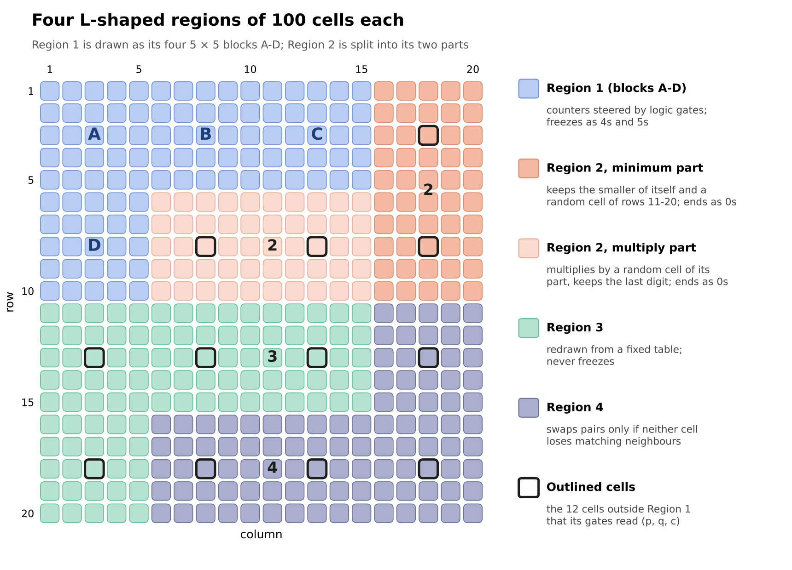
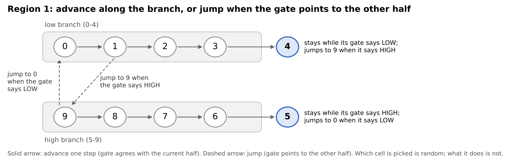

# SSIE 501 Black Box: Model Specification, Methods and Conclusions

Group 5 · Fall 2026 · Part 2

> A live, editable version of this document is kept as a shared doc; this file is the repository copy. Every number is printed by a script in this repository and re-tested by `check_claims.py` (42/42 pass).

## Purpose and how to use this document

The Black Box is four rules, one per region, running side by side on one grid. The rules are not independent: Region 1 reads a few cells in the other three regions, Region 2 reads the bottom half of the grid, and Region 4 counts neighbours across region borders. This document specifies each rule precisely enough to rebuild the box without our code.

- **Part A is the model:** the grid, one step of the box as numbered instructions, and every table you need.
- **Part B is the methods and conclusions:** what we measured, which explanations we tested and rejected, and why we believe the rules in Part A.

You can rebuild the model with a spreadsheet, a program in any language, or graph paper and a random-number table. Section A9 lists the numbers a correct rebuild should reproduce.

Every finding carries a claim tag such as (C12). The tag points to the script that computes it, the output it printed and an automatic test, all in this repository (see [References](#references-where-every-claim-is-proven)). The code is the evidence; this document is the model.

---

## Part A. The model

### A1. The grid, the four regions and what each cell holds

The box is a 20 × 20 grid of cells, and each cell holds a whole number, usually 0 to 9. The grid is cut into four L-shaped regions of exactly 100 cells each; the cut moves 5 columns at the halfway row (C01). Rows and columns are numbered 1 to 20 from the top-left corner (the code counts from 0). A cell is written (row, column).

| Region | Position | Cells (rows, columns) | What it does over time |
|---|---|---|---|
| 1 | top-left L | rows 1-5, columns 1-15 **and** rows 6-10, columns 1-5 | fills up with 4s and 5s and freezes |
| 2 | top-right L | rows 1-5, columns 16-20 **and** rows 6-10, columns 6-20 | fills up with 0s and freezes |
| 3 | bottom-left L | rows 11-15, columns 1-15 **and** rows 16-20, columns 1-5 | never freezes; mostly 0s, 1s and 2s |
| 4 | bottom-right L | rows 11-15, columns 16-20 **and** rows 16-20, columns 6-20 | values only trade places; same-value clusters form |

Region 2 has two parts that follow different rules:

- **Minimum part:** rows 1-10, columns 16-20 (50 cells).
- **Multiply part:** rows 6-10, columns 6-15 (50 cells).

**Blocks.** For Region 1 it helps to cut the grid into sixteen 5 × 5 blocks. Region 1 is four of them: block **A** (rows 1-5, columns 1-5), block **B** (rows 1-5, columns 6-10), block **C** (rows 1-5, columns 11-15) and block **D** (rows 6-10, columns 1-5).



**What a cell holds.** Each cell stores only its current value. Nothing is hidden: the next step depends only on the grid you can see and on chance.

**The starting grid.** Reset fills every cell with a random digit 0-9, each digit about equally likely (9.6% to 10.3% of cells each, C04). Every Reset gives a different grid.

### A2. One step of the box

One press of "Next n Step" with n = 1 is one step. In one step each region changes at most one cell (Region 4: one pair).

All our data was recorded one step at a time. We treat a press with n = 10 as ten single steps, because Part 1 found that entropy depends only on the total number of steps, not on how presses are split (Kruskal-Wallis p > 0.3).

The regions take turns in a fixed order, and each one sees the changes made earlier in the same step:

1. **Region 1:** pick one of its 100 cells at random, each equally likely, and apply the Region 1 rule (A5).
2. **Region 2:** pick one of its 100 cells at random and apply the Region 2 rule (A6).
3. **Region 3:** pick one of its 100 cells at random and apply the Region 3 rule (A3).
4. **Region 4:** pick a pair of its cells (A4) and apply the Region 4 rule.
5. The step counter goes up by 1.

The order only matters for Region 4, whose neighbour counts can include border cells that Region 2 or 3 changed a moment earlier. With this order every one of the 6,033 recorded swaps (D, H and G2; see B1) obeys the Region 4 rule; with all regions reading the old grid, 9 do not, all of them next to a region border (C40).

**Evidence that this is how picking works.**

- Regions 1-3 never changed more than one cell in a step, and Region 4 always changed 0 or exactly 2 cells, in all 91 recorded runs (C02).
- The changed cell was the next cell in reading order only 1.02% of the time, which is what random picking among 100 cells gives. A top-to-bottom sweep would give about 100% (C03).

**Random numbers.** "Draw U" means a random number between 0 and 1: `RAND()` in Excel, `random()` in Python, or a 4-digit random number divided by 10,000 by hand.

- An event "with probability P" happens when U < P.
- To pick a value from a table, add up its probabilities from the top and stop at the first value where the running total is greater than U. The tables below print these running totals.

### A3. Region 3 rule: redraw the picked cell

The picked cell gets a brand-new value drawn from one fixed table; its old value and its neighbours play no part (C06, C08). Draw U and read the first row whose running total is greater than U.

| New value | Probability | Running total |
|---|---|---|
| 0 | 0.3634 | 0.3634 |
| 1 | 0.3292 | 0.6926 |
| 2 | 0.1690 | 0.8616 |
| 3 | 0.0756 | 0.9372 |
| 4 | 0.0338 | 0.9710 |
| 5 | 0.0159 | 0.9869 |
| 6 | 0.0076 | 0.9945 |
| 7 | 0.0032 | 0.9977 |
| 8 | 0.0015 | 0.9992 |
| 9 | 0.0005 | 0.9997 |
| 10 | 0.0002 | 0.9999 |
| 11 | 0.0001 | 1.0000 |

The new value can equal the old one, so a picked cell stays the same about 28% of the time once the region has settled. That is why Region 3 shows a change in only about 73% of steps (C09).

**A short way to remember it.** 0 about 36% of the time; otherwise 1 or more, where each value is about 0.47 times as likely as the one below it. This is the closest simple description we found, but the measured table fits clearly better, so the model uses the table (C33).

**The values 10-13.**

- The table has no upper limit at 9, so very rarely it produces 10 or more. These are the "out of bounds" values Dr. Costa called a glitch.
- They appear only in Region 3 (5,635 cell-steps in our data, none in the other regions), at the rate the tail of the table predicts (C10).
- Most likely the designer meant to cap the draw at 9. A rebuild that wants to look like the page should keep values up to 13; one that wants the intended rule can cap at 9.
- Region 1's gates read a value of 10 or more as HIGH (A5).

### A4. Region 4 rule: swap only if neither cell loses matching neighbours

Two cells trade values only when the trade helps at least one of them match its neighbours and hurts neither. Values are never created or destroyed (C11, C12).

1. **Pick the pair.** Pick two cells of Region 4 at random. If they are the same cell, or hold the same value, throw the pick away and pick again, until you have two different cells A and B holding different values a and b. (If all 100 cells hold the same value, skip Region 4 this step.)
2. **Count before.** Count how many of A's 8 surrounding cells hold a (call it A-before), and how many of B's 8 surrounding cells hold b (B-before).
3. **Count after.** Imagine the swap done (A now holds b, B holds a). Count how many of A's neighbours hold b (A-after) and how many of B's neighbours hold a (B-after). If A and B are neighbours of each other, use the swapped values when counting.
4. **Swap** only if A-after ≥ A-before **and** B-after ≥ B-before **and** at least one of them went up. Otherwise nothing happens.

**What counts as a neighbour.**

- The 8 surrounding cells (sides and corners). Cells in other regions count.
- The grid does not wrap at its edges, so edge cells have fewer neighbours.
- Of 12 definitions we tried (4 or 8 neighbours, wrapped or not, matching values or closeness of values), only this one has no exceptions (C13).

**How sure we are.**

- Every recorded swap raised the total number of matching neighbours: 4,022 of 4,022 in the discovery runs, 2,002 of 2,002 in the held-out runs and 9 of 9 in Group 2's frames (C12).
- The stricter "neither cell loses" rule held for all **6,033** recorded swaps: 4,022 in D, 2,002 in H and 9 in G2 (C40).
- With this rule and no swap probability, the rebuilt box makes 132 Region 4 changes per run against 133 in the real box (C41). The 54-96% "swap rates" in our earlier version (C14) were the swaps this rule rejects: ones that raise the total but cost one of the two cells a match.

### A5. Region 1 rule: counters steered by logic gates

**Two branches.** Values live on two one-way branches that end in 4 and 5 (C16).

- **Low branch (0-4):** 0 → 1 → 2 → 3 → **4**.
- **High branch (5-9):** 9 → 8 → 7 → 6 → **5**.



**Each cell has a target half.** At every moment, each Region 1 cell has a *target*: HIGH (5-9) or LOW (0-4). The target is the output of a fixed yes/no rule, a *gate*, that looks at whether a few specific cells are HIGH (5 or more, including 10+) or LOW (0-4) right now. Nothing random goes into the target.

**What one Region 1 update does.**

1. Pick one of the 100 cells, each equally likely. If it holds 10 or more, nothing happens.
2. Work out its target from its gate (table below).
3. If the target is the **other** half, the cell **jumps** to the start of that half: a low cell (0-4) becomes **9**, a high cell (5-9) becomes **0**.
4. If the target is the half it is already in, it **advances** one step along its branch: 0-3 go up by 1, 6-9 go down by 1, and a 4 or a 5 stays where it is.

**Where each gate looks.** All four blocks use the same 25 gate formulas, one for each position inside the block. Positions are written (row, column) inside the 5 × 5 block, counted from 1, so (1, 1) is a block's top-left cell.

- **s(i, j)** is the cell at position (i, j) of the block's **source block**. Blocks A, B and D read themselves; **block C reads block A**.
- **p**, **q** and **c** are single cells outside Region 1. Each block has its own three:

| Block | Its cells | Source block | p | q | c |
|---|---|---|---|---|---|
| A | rows 1-5, columns 1-5 | A | (8, 8) Region 2 multiply | (8, 13) Region 2 multiply | (8, 18) Region 2 minimum |
| B | rows 1-5, columns 6-10 | B | (13, 3) Region 3 | (13, 8) Region 3 | (13, 13) Region 3 |
| C | rows 1-5, columns 11-15 | **A** | (18, 8) Region 4 | (18, 13) Region 4 | (18, 18) Region 4 |
| D | rows 6-10, columns 1-5 | D | (3, 18) Region 2 minimum | (18, 3) Region 3 | (13, 18) Region 4 |

(Each of p, q and c is the centre cell of some other 5 × 5 block.)

**The 25 gates.** "HIGH when ..." gives the condition for a target of HIGH; otherwise the target is LOW. AND means both, OR means at least one.

| Position | Target is HIGH when ... |
|---|---|
| (1, 1) | s(3, 1) is LOW |
| (1, 2) | s(1, 5) is HIGH AND s(1, 3) is LOW |
| (1, 3) | s(3, 2) is HIGH |
| (1, 4) | s(5, 2) is HIGH AND s(4, 5) is LOW |
| (1, 5) | at least one of s(1, 4), s(2, 2), s(2, 3) is HIGH, AND s(5, 3) is LOW |
| (2, 1) | s(2, 5) is HIGH |
| (2, 2) | p AND q are both HIGH |
| (2, 3) | s(4, 4) is HIGH AND p is HIGH |
| (2, 4) | s(4, 1) is HIGH |
| (2, 5) | s(1, 2) OR s(3, 1) is HIGH |
| (3, 1) | s(4, 2) is HIGH AND s(1, 3) is LOW |
| (3, 2) | s(2, 4) is HIGH AND s(1, 4) is LOW |
| (3, 3) | s(1, 1) is LOW |
| (3, 4) | s(1, 5) is LOW AND at least one of s(2, 2), s(4, 4) is HIGH |
| (3, 5) | s(3, 4) is HIGH |
| (4, 1) | s(3, 4) AND s(5, 4) are both HIGH |
| (4, 2) | s(3, 2) is LOW AND at least one of s(3, 1), s(3, 5) is HIGH |
| (4, 3) | s(2, 5) is HIGH |
| (4, 4) | c is HIGH |
| (4, 5) | s(3, 2) is HIGH AND s(4, 3) is LOW |
| (5, 1) | s(1, 4) is HIGH |
| (5, 2) | s(1, 1) AND s(2, 1) are both HIGH, AND s(4, 5) is LOW |
| (5, 3) | s(3, 2) is HIGH |
| (5, 4) | s(4, 3) is LOW AND at least one of s(3, 2), s(5, 4) is HIGH |
| (5, 5) | s(3, 2) is HIGH |

**Example.** Cell (1, 1) is position (1, 1) of block A, so its target is HIGH when cell (3, 1) is LOW. Say (1, 1) holds 2. If (3, 1) holds 7, the target is LOW, so (1, 1) advances to 3. If (3, 1) holds 1, the target is HIGH, so (1, 1) jumps to 9. Cell (1, 11) is position (1, 1) of block C, whose source is block A, so it also listens to cell (3, 1).

**Why it freezes, and why mostly at 4.**

- A 4 or a 5 whose gate agrees with its half never moves, so the region settles: by the last recorded step, 98-99% of its cells are 4 or 5 (C17, C41).
- It keeps moving a little because some gates read cells outside Region 1 (p, q, c). Region 3 keeps redrawing, so those inputs flip now and then, and the change spreads through the gates.
- The mix of 4s and 5s at the end is whatever the gates settle into; the rebuilt box ends with 78% 4s against 80% in the real box (C41).

**How sure we are.**

- The two kinds of move are certain: 34,547 changes in the discovery runs and 17,148 in the held-out runs, with no other kind of change (C16).
- The gates decide every jump. In all three datasets, none of which was used to find them, the gates predict jump or advance correctly for **48,476 of 48,476** changes from 0-3 or 6-9: 32,400 in D, 16,046 in H and 30 in G2 (C35).
- That includes the very first step after Reset, which only Group 1's runs record: 47 of 47 Region 1 changes (C42).
- A cell sitting at 4 or 5 whose gate agrees with its half **never** jumped: 0 jumps in 13.06 million cell-steps. When its gate disagrees, it jumps 1.04% of the time per step, which is the 1-in-100 chance of being picked (C36).

### A6. Region 2 rule: keep the smaller, or multiply and keep the last digit

0 never changes in either part, so Region 2 fills with zeros (C21). Pick one of its 100 cells at random, then:

**Minimum part** (rows 1-10, columns 16-20).

1. Pick a partner cell at random from **rows 11-20, any column** (200 cells, each equally likely).
2. The picked cell becomes the **smaller** of its own value and the partner's value.

So a cell here can only stay the same or go down, and the zeros of Region 3 drag it to 0.

**Multiply part** (rows 6-10, columns 6-15).

1. Pick a partner cell at random from the **multiply part itself** (50 cells; it may pick the cell itself).
2. Multiply the two values and keep only the last digit: 4 × 7 = 28 → 8, 3 × 9 = 27 → 7, anything × 0 → 0.

**The odd/even rule follows from the multiplication.** Multiplying an even number always ends in an even digit, and multiplying 5 always ends in 0 or 5, so in the multiply part even values stay even and a 5 can never rise (C22, C23). This is the instructor's odd/even hint.

**How sure we are (D, H and G2; C38, C39).**

- Minimum part: **7,751** changes, **0** rises, and every new value was present somewhere in rows 11-20 at that step.
- Multiply part: all **7,439** changes equal (old value × a value present in the multiply part) with the last digit kept.
- With these two rules and no fitted probabilities, the rebuilt box makes 165 Region 2 changes per run, the same as the real box (C41).

### A7. Worked examples from a real run

Each example below is a real change in held-out run 1 (shared dataset, trajectory 001), checked against the rules (C34).

**Region 1, advance.** Cell (2, 4) holds 9. It is position (2, 4) of block A, so its target is HIGH when cell (4, 1) is HIGH. Cell (4, 1) holds 8 (HIGH), so the target is HIGH, the half (2, 4) is already in. It advances: 9 → **8**.

**Region 1, jump.** Cell (3, 12) holds 0. It is position (3, 2) of block C, whose source is block A, so its target is HIGH when cell (2, 4) is HIGH and cell (1, 4) is LOW. Cell (2, 4) holds 8 and cell (1, 4) holds 1, so the target is HIGH but the cell is LOW. It jumps: 0 → **9**.

**Region 2, multiply part.** Cell (10, 10) holds 1, and the multiply part contains a 6. With that partner, 1 × 6 = 6: 1 → **6**. A 2 could never do this, because 2 × anything ends in an even digit.

**Region 2, minimum part.** Cell (3, 16) holds 6. Rows 11-20 held forty-four 1s at that step; with a 1 as partner, min(6, 1) = 1: 6 → **1**.

**Region 3, redraw.** Cell (15, 13) holds 0 and is redrawn as **1** (probability 0.33).

**Region 4, swap.** Cell A (18, 16) holds 0 and cell B (19, 11) holds 6. Their neighbourhoods before the swap, picked cell in brackets:

```text
A before      B before
1  8  8       6  4  6
8 [0] 8       0 [6] 3
6  8  5       0  7  3
```

- **Before:** A's neighbours hold no 0 (A-before = 0); B's neighbours hold two 6s (B-before = 2).
- **After** (A holds 6, B holds 0): A's neighbours hold one 6 (A-after = 1); B's neighbours hold two 0s (B-after = 2).
- A went up (0 → 1) and B did not go down (2 → 2), so the swap happens. In the real run it happened.

### A8. The minimum model and smaller boxes

What each update needs:

| Region | What one update reads | Smallest working unit |
|---|---|---|
| 3 | nothing but chance | 1 cell |
| 1 | the picked cell and the 1-4 cells its gate reads (some outside Region 1) | the 25-cell gate network plus its outside inputs |
| 2, minimum part | the picked cell and one random cell of rows 11-20 | 1 cell plus a pool of partner cells |
| 2, multiply part | the picked cell and one random cell of its own part | 2 cells |
| 4 | two cells and the 8 neighbours of each | a block with room for pairs and their neighbours |

- **The regions are coupled.** Region 1 reads cells in Regions 2, 3 and 4 (A5); Region 2's minimum part reads rows 11-20 (Regions 3 and 4); Region 4 counts neighbours across borders. Region 3 reads nothing, so it is the box's only source of fresh randomness, and its noise reaches Region 1 and Region 2.
- **Region 1 cannot be shrunk freely.** Its gates name specific positions, so it is a fixed 25-cell network, repeated in four blocks. A smaller box can keep one block and its outside inputs; a different-sized network would be a different rule.
- **Time depends on region size.** With 100 cells, each cell is picked on average once every 100 steps. A region of N cells picks each cell once every N steps, so it settles N/100 times as fast. Keep the regions the same size (or keep the ratio) so their speeds stay in step, as Lauren noted in the group chat.
- These are consequences of the rules; we could not test other sizes, because the real box has only one.

### A9. How to check a rebuild

A correct rebuild, run 2,000 steps from a random grid and averaged over many runs, should land near the middle column; the real box gives the right column. We checked this ourselves with an implementation of Part A ([`blackbox/gate_model.py`](blackbox/gate_model.py)) started from the 30 held-out starting grids, 5 runs each (C41).

| Statistic after 2,000 steps (mean) | This model | Real box (held-out runs) |
|---|---|---|
| Region 1: cells changed per run | 540 | 572 |
| Region 2: cells changed per run | 165 | 165 |
| Region 3: cells changed per run | 1,461 | 1,461 |
| Region 4: cells changed per run | 132 | 133 |
| Region 1: entropy at the end (bits) | 0.79 | 0.78 |
| Region 2: entropy at the end (bits) | 0.04 | 0.04 |
| Region 3: entropy at the end (bits) | 2.09 | 2.09 |
| Region 4: entropy at the end (bits) | 3.26 | 3.26 (never changes) |
| Region 1: share of cells that are 4 | 78% | 80% |
| Region 1: share of cells that are 4 or 5 | 99% | 98% |
| Region 2: share of cells that are 0 | 99% | 99% |

All four regions match. The one gap is Region 1's late activity, and it sits in block D alone (C43, B4).

---

## Part B. Methods and conclusions

### B1. Data: what we recorded and how

Every rule was found on one dataset and then tested on another that was never used to find it. All datasets record the grid of the numerical page (`BlackBox_N.php`) after every single step, starting from Reset.

| Dataset (short name) | Used for | Size | How it was collected |
|---|---|---|---|
| **D** · Discovery: Group 1 scraper runs | finding the Region 2-4 structure and the Region 3 table | 61 runs × 2,000 steps | Python script (`requests` + `BeautifulSoup`): press Reset, press "Next n Step" with n = 1, read the 20 × 20 grid from the page, repeat |
| Marcus's runs | finding the Region 1 gates, the two parts of Region 2 and the strict Region 4 rule | 32 runs (21,720 steps) + 200 short runs (10,000 steps) | Marcus's own browser scripts, each recording checked so every "after" grid matched the next "before" |
| **H** · Held-out: shared dataset (W. Zhang, posted for the class) | testing only | 30 runs × 2,000 recorded grids | Selenium browser controller from the shared starter notebook |
| **G2** · Group 2 frames | extra check | 1 run × 40 steps | Python script `blackbox_collect.py` (`requests` + `BeautifulSoup`) |

**Which data each result uses.** D, H and G2 are the short names in the table above. Because the rules for Regions 1, 2 and 4 were found on Marcus's runs, D, H and G2 are all test data for them. The full list, claim by claim, is in [References](#references-where-every-claim-is-proven).

| Results | Data used |
|---|---|
| C01-C34 (selection, Region 3 table, earlier Region 4, 1 and 2 analysis, entropy) | Mostly found on D and tested on H; some use D, H and G2 together (see References) |
| C35-C40 (Region 1 gates, settled cells, the two Region 2 parts, the strict Region 4 rule, update order) | D, H and G2: every recorded change |
| C41 (rebuilt box, A9) | H: rebuilt from its 30 starting grids |
| C42 (first step after Reset) | D only, the only data that include the Reset grid |
| C43 (where the rebuilt box still differs) | D and H (91 runs of 2,000 steps) |

- **The held-out shared dataset.** Wuyang Zhang, *Black Box Shared Dataset* (files `trajectory_001_FULLBOX.npz` to `trajectory_030_FULLBOX.npz`, dated 23 October 2026). Each file holds the full 20 × 20 grid after steps 1 to 2,000 (`full_history`), the step numbers (`recorded_steps`) and the Region 2 cells (`r2_history`). The copy in this repository (`data/shared_dataset/`) is identical to the posted zip, checked file by file.
- **How the page numbers steps.** After Reset, the page labels the fresh grid "Current step: 1". H's first recorded grid is also labelled step 1, so it is most likely the Reset grid itself. D starts at the Reset grid too, and its first step is tested in C42.
- **Data not in this repository.** The Group 1 runs and Group 2's frames are not included until those groups agree to share them, and Marcus's runs are kept by Marcus. The scripts test them when they are placed in `data/` (see `data/README.md`); the numbers in this document were produced with all three present.
- **Checks on the data.** Our loader refuses any file whose frames are not consecutive single steps. No held-out starting grid appears in the discovery set: 91 resets gave 91 different grids (C04).
- **Only the visible grid.** The scripts read the grid exactly as the page shows it. The rules were inferred from those recorded grids, not from the page's program.
- **One step = one press with n = 1.** Steps are numbered from Reset.
- **AI tools.** AI assistants were used to write recording scripts, to search the recorded grids for candidate rules, and to run the tests. Every rule in Part A was kept only after it passed the held-out runs; Marcus also had a second, independent search start from scratch, and it reached the same rules.

The analysis is a set of Python scripts in this repository, grouped by region. Each finding is printed with its claim tag and re-tested by `check_claims.py`; all 44 checks pass.

### B2. How each rule was found: what we tested, rejected and kept

For every region we followed the same five steps. Each explanation below was kept only if it survived the held-out runs.

1. List every change that ever happens in the region (old value → new value, how many cells per step).
2. Look for what decides each change: the old value, the neighbours, other cells, the position, the time since Reset, the cell's own history.
3. State the simplest rule that accounts for every change.
4. Test the rule on the held-out runs, which played no part in finding it.
5. Rebuild the whole box from the rules and compare it with the held-out runs (C41).

| Region | Explanation tested | Test | Result | Claim |
|---|---|---|---|---|
| All | Cells update in a top-to-bottom, left-to-right sweep (our Part 1 claim) | How often the next change is the next cell in reading order | 1.02% (random picking gives about 1%) | **Rejected** (C03) |
| All | One random cell per region per step (Region 4: one pair) | Cells changed per step; predicted vs observed change counts | Never more than 1 (or 2); counts within 0.2-0.5% | **Kept** (C02, C09, C17) |
| All | Cells that match their neighbours stop changing (our Part 1 claim) | Change rate by number of matching neighbours | Flat: varies by at most 13 percentage points | **Rejected** (C05) |
| All | All regions read the grid as it was at the start of the step | Region 4 swaps that obey its rule (D, H, G2) | 6,024 of 6,033 | **Rejected** (C40) |
| All | Regions update in order 1, 2, 3, 4 | Region 4 swaps that obey its rule (D, H, G2) | 6,033 of 6,033 | **Kept** (C40) |
| 3 | The new value depends on the old value | Transition table rows | Rows nearly identical | **Rejected** (C06) |
| 3 | The new value depends on the neighbours | P(new = 0) by number of zero neighbours | 0.31-0.33 throughout | **Rejected** (C08) |
| 3 | Redraw from one fixed table | Held-out distribution and change count | χ² p = 0.97; count off by 0.2% | **Kept** (C09) |
| 3 | A textbook distribution (Poisson, geometric, negative binomial and two zero-inflated forms) | Likelihood (AIC) against the free table | Table better by 128 AIC points; Poisson worst | **Rejected** (C33) |
| 4 | Values only trade places | Exact swaps; value counts over time | 6,033 of 6,033 exact swaps; counts never change | **Kept** (C11) |
| 4 | Random swaps | Matching-neighbour gain of every swap | Every swap had gain ≥ 1, in all datasets | **Rejected** (C12) |
| 4 | 11 other definitions of a "better" swap | Held-out swaps that break each definition | 126 to 828 exceptions each | **Rejected** (C13) |
| 4 | Total gain ≥ 1, accepted with a measured probability | Needs a fitted rate table (0.54-0.96) | Replaced by the stricter rule below, which needs no rates | **Superseded** (C14) |
| 4 | Neither cell loses and one gains, always accepted | Recorded swaps (D, H, G2); rebuilt Region 4 activity | 6,033 of 6,033; 132 vs 133 changes per run | **Kept** (C40, C41) |
| 4 | Its slow-down is caused by Regions 1-2 (our Part 1 open question) | Predict the swap rate from Region 4's own grid only | Matches within 0.01 per step after step 200 | **Not needed** (C15) |
| 1 | Any value can change into any other | All observed changes | Only advance or jump, no exceptions | **Kept: two branches** (C16) |
| 1 | A neighbour decides whether a cell jumps | Jump rate by each of the 8 surrounding cells' direction and value | Always 10-24%, never near 0% or 100% | **Rejected** (C20) |
| 1 | Jumps depend on the cell's own history (time since its last change) | Jump vs advance on the same 48,476 changes; log-likelihood | Best guess right 86% of the time, mostly by always guessing "advance" | **Rejected** (C18, C19, C37) |
| 1 | Logic gates on specific cells decide the target half | Jump vs advance on every recorded change (D, H, G2); settled cells; first step after Reset | 48,476 of 48,476; 0 jumps in 13.06 million cell-steps while the gate agrees; 47 of 47 | **Kept** (C35, C36, C42) |
| 2 | 0 can change | Changes away from 0 | None, in all datasets | **Rejected: 0 is a dead end** (C21) |
| 2 | A changing cell copies a neighbour | New value among own neighbours vs a random cell's | 77% vs 73% | **Rejected** (C25) |
| 2 | Rises only to multiples of gcd(value, 10) (the instructor's odd/even hint) | Rises seen vs predicted; violations | Exact match; zero violations | **Kept, explained by the multiply part** (C22) |
| 2 | Minimum part: min(cell, random cell of rows 11-20) | Changes in rows 1-10, columns 16-20 (D, H, G2) | 0 rises; every new value present in rows 11-20 (7,751 of 7,751) | **Kept** (C38) |
| 2 | Multiply part: (cell × random cell of the part) mod 10 | Changes in rows 6-10, columns 6-15 (D, H, G2) | 7,439 of 7,439 | **Kept** (C39) |
| 1 | The page picks some Region 1 cells more often than others | Pick rate of every Region 1 cell, from cells that must change when picked (D, H) | 0.90-1.16% per step for every cell, mean 1.00% | **Rejected** (notebook, Section 5) |

**Why the two Region 1 explanations looked alike.** A cell's waiting time does carry information (C18, C19), but only indirectly. A cell sits still while its gate inputs stay put, and the inputs change only now and then, so the longer a cell has waited, the more likely its inputs have shifted. The neighbour test (C20) could not see the gates because the inputs are not the 8 surrounding cells: cell (1, 1) listens to cell (3, 1), two rows down, and some gates read cells in other regions.

**Two independent analyses agree.** Marcus's analysis of his own runs and ours of the Group 1 runs reached the same two Region 1 branches, the same Region 4 swap structure and the same Region 3 numbers (0 about 36%, 1 about 33%, 2 about 17%, 3 about 7%).

### B3. Conclusions: what the box is and why we believe it

The Black Box is four rules sharing one screen, each built from a different idea: a random redraw, a sorting rule, a network of logic gates, and a pair of arithmetic rules that trap zeros. Only Region 3 creates fresh randomness; the other regions add chance only through which cells they pick.

| Region | What it is | Why we believe it |
|---|---|---|
| 3 | A pure noise source: the picked cell is redrawn from a fixed table, with no memory and no neighbours. Its entropy settles at the table's own entropy, 2.14 bits, against 2.09 measured (C27). The values 10-13 are the table's uncapped tail, which is why they appear only here. | The held-out runs follow the same table (χ² p = 0.97), and the predicted number of changes is off by 0.2% (C09). |
| 4 | A sorting process like Schelling's segregation model: two cells trade places only if neither ends up with fewer same-value neighbours and one gains. Counts never change, so its entropy is fixed at 3.26 bits. It slows down because acceptable swaps run out as clusters form. | Every one of the 6,033 recorded swaps obeys the rule (C40). Its own grid predicts its slow-down (C15), and the rebuilt box matches its activity (C41). |
| 1 | A Boolean network, like the random Boolean networks used to model gene regulation: each cell has a target half set by a logic gate over a few other cells, and moves one step at a time toward a 4 or a 5, jumping across when its target flips. It freezes when the network reaches a stable state; inputs from Region 3 keep nudging it. | The gates predict all 48,476 recorded jumps and advances, including the first step after Reset, and settled cells never move while their gate agrees (C35, C36, C42). |
| 2 | Two arithmetic rules with 0 as a dead end: the minimum part copies small values from the bottom half, and the multiply part keeps the last digit of a product, so even numbers stay even and 5 never rises. | Every recorded change fits its part's rule (C38, C39), and the rebuilt box matches Region 2's activity and end state exactly (C41). |

**Why entropy falls in some regions and not others.** This was the instructor's question on Part 1 (C26, C27).

- Regions 1 and 2 fall (3.25 to 0.78 bits and 3.26 to 0.04 bits) because their rules trap cells: Region 1 in stable gate states at 4 and 5, Region 2 at 0.
- Region 4 cannot change, because swaps keep the value counts.
- Region 3 levels off at 2.09 bits, because it keeps redrawing from the same table.

**Why we trust the model as a whole.** A box built only from the rules in Part A, started from the 30 held-out starting grids, reproduces the real box's activity and end state in all four regions (C41). Apart from the Region 3 table, the model has no fitted probabilities.

### B4. Limitations and open questions

1. **Region 1's late activity, block D.** In steps 1,001-2,000 the real box and the rebuilt box agree in blocks A, B and C, but block D (rows 6-10, columns 1-5) changes 26.0 times per run in the real box against 14.4 in the rebuilt one, and stays busy (more than 40 late changes) in 24 of 91 real runs against 9 of 91 rebuilt ones (C43). Every recorded change still obeys the gates, the page picks Region 1 cells uniformly, and block D's outside inputs flip about as often as in the model, so the difference is in how often block D settles into a stable state. We have not found its cause.
2. **Region 3's table is measured, not derived.** We found no simple formula that fits it as well as the table (C33).
3. **Region 2 neighbour effect.** Drops to 0 are more likely next to 0s (C25). This is probably a side effect of zeros spreading through each part, which raises both the chance of a 0 partner and the number of 0 neighbours; we have not tested this directly.
4. **Step size.** All data was recorded one step at a time; presses with n > 1 are assumed to equal n single steps.
5. **Box size.** The minimum-model statements in A8 follow from the rules but could not be tested, because the real box has only one size.
6. **Only the visible grid.** The rules reproduce everything the page shows; they are our model of the page, not its code.

### B5. Team contributions

> **To be completed.** This is a placeholder. The exact contribution of each Group 5 member to Part 2 will be filled in accurately before final submission. The Region 1 gates, the two parts of Region 2 and the strict Region 4 rule were found by Marcus Washington.

| Member | Contribution to Part 2 |
|---|---|
| Kieenjal Davvey | to be completed |
| Tanya Flash | to be completed |
| Shamim Sharbaf | to be completed |
| Lauren Reed | to be completed |
| Marcus Washington | to be completed |

---

## References: where every claim is proven

All code, outputs and figures are in the public repository [sharbafshamim/ssie501-blackbox-rules](https://github.com/sharbafshamim/ssie501-blackbox-rules). To check a claim, search its tag (for example `C12`) in the script listed below and in that script's output, `results/<script name>.txt`; the numbers are also saved in `results/metrics/<script name>.json`. `python run_all.py` reruns every script, and `results/claims_check.txt` records the automatic test of every claim (44 of 44 pass). The notebook `notebooks/rule_tests_three_datasets.ipynb` repeats the C35-C43 tests with tables and figures.

**Data keys:** D = Group 1 scraper runs (61 runs) · H = shared held-out dataset, W. Zhang (30 runs) · G2 = Group 2 frames (40 steps). "Found on D, tested on H" means the rule was worked out from D and then checked on H, which played no part in finding it.

### Every claim

| Claim | What it shows | Data used | Script |
|---|---|---|---|
| C01 | Four L-shaped regions of 100 cells | D | `analysis/01_selection.py` |
| C02 | Regions 1-3 change at most 1 cell per step; Region 4 changes 0 or 2 | D, H, G2 | `analysis/01_selection.py` |
| C03 | Cells are picked at random, not top-to-bottom | D | `analysis/01_selection.py` |
| C04 | Reset gives a new random grid every time | starting grids of D and H | `analysis/01_selection.py` |
| C05 | Change does not depend on matching neighbours | D | `analysis/01_selection.py` |
| C06 | Region 3's new value ignores the old value | D | `analysis/02_area3_redraw.py` |
| C07 | Region 3's draw distribution | D | `analysis/02_area3_redraw.py` |
| C08 | Region 3's new value ignores the neighbours | D | `analysis/02_area3_redraw.py` |
| C09 | Region 3's rule holds on held-out runs | found on D, tested on H | `analysis/02_area3_redraw.py` |
| C10 | Values 10-13 appear only in Region 3, as the table's tail | D and H | `analysis/02_area3_redraw.py` |
| C11 | Region 4 changes are exact swaps | D, H, G2 | `analysis/03_area4_swaps.py` |
| C12 | Every swap raises the number of same-value neighbours | D, H, G2 | `analysis/03_area4_swaps.py` |
| C13 | No other of 12 neighbour definitions works | H | `analysis/03_area4_swaps.py` |
| C14 | Earlier swap rates by gain size (superseded by C40) | D and H | `analysis/03_area4_swaps.py` |
| C15 | Region 4's slow-down follows from its own grid | found on D, tested on H | `analysis/03_area4_swaps.py` |
| C16 | Region 1 moves are only advance or jump | D, H, G2 | `analysis/04_area1_branches.py` |
| C17 | Cells holding 0-3 or 6-9 always move when picked; 4 and 5 are near-dead ends | H (end state from D and H) | `analysis/04_area1_branches.py` |
| C18 | Region 1 jump rate depends on the cell's history (explained by the gates, B2) | D and H | `analysis/04_area1_branches.py` |
| C18b | High branch jumps more often than low branch | D and H | `analysis/04_area1_branches.py` |
| C19 | Jump rate rises with time since the last move | D and H | `analysis/04_area1_branches.py` |
| C20 | The 8 surrounding cells do not decide jumps | D | `analysis/04_area1_branches.py` |
| C21 | Region 2: 0 never changes | D, H, G2 | `analysis/05_area2_parity.py` |
| C22 | Region 2 rises follow the mod-10 rule | D, H, G2 | `analysis/05_area2_parity.py` |
| C23 | Region 2 drops are unrestricted | D | `analysis/05_area2_parity.py` |
| C24 | Earlier Region 2 change probabilities (superseded by C38, C39) | D and H | `analysis/05_area2_parity.py` |
| C25 | Region 2 drops to 0 more often next to 0s | D | `analysis/05_area2_parity.py` |
| C26 | Entropy curves per region | H | `analysis/06_entropy.py` |
| C27 | Each entropy curve follows from its rule | found on D, tested on H | `analysis/06_entropy.py` |
| C28 | Earlier rebuilt box vs real runs | found on D, tested on H | `analysis/07_simulate.py` |
| C29 | Earlier rebuilt box: final states | found on D, tested on H | `analysis/07_simulate.py` |
| C30 | Branch asymmetry and Region 1's 4s (earlier model) | found on D, tested on H | `analysis/07_simulate.py` |
| C31 | Earlier printed model tables | D | `analysis/08_model_spec.py` |
| C32 | Earlier written model vs real runs | found on D, tested on H | `analysis/08_model_spec.py` |
| C33 | Region 3 is not a textbook distribution | found on D, also scored on H | `analysis/09_area3_family.py` |
| C34 | Worked examples in A7 obey the rules | H (run 1) | `analysis/10_worked_example.py` |
| C35 | Region 1 gates predict every jump and advance (48,476 of 48,476) | D, H, G2 | `analysis/11_gate_rules.py` |
| C36 | Settled Region 1 cells jump only when their gate disagrees | D, H, G2 | `analysis/11_gate_rules.py` |
| C37 | The earlier waiting-time rule is worse than the gates (86% vs 100%) | rates found on D; scored on D, H, G2 | `analysis/11_gate_rules.py` |
| C38 | Region 2 minimum part: never rises; new value comes from rows 11-20 | D, H, G2 | `analysis/11_gate_rules.py` |
| C39 | Region 2 multiply part: every change is a product, last digit kept | D, H, G2 | `analysis/11_gate_rules.py` |
| C40 | Region 4 strict swap rule (6,033 of 6,033) and update order 1-4 | D, H, G2 | `analysis/11_gate_rules.py` |
| C41 | The rebuilt box (Part A) matches the real runs (A9) | H, rebuilt from its 30 starting grids | `analysis/11_gate_rules.py` |
| C42 | The first step after Reset follows the gates (47 of 47) | D only (the only data that include the Reset grid) | `analysis/11_gate_rules.py` |
| C43 | Late Region 1 activity differs from the rebuilt box only in block D | D and H (91 runs) | `analysis/11_gate_rules.py` |

### Supporting code

| File | What it is |
|---|---|
| `blackbox/gate_model.py` | Part A as code: the rebuilt box used in A9 and C41-C43 |
| `blackbox/rule_checks.py` | The rule checks behind C35-C42, applied to every recorded change |
| `blackbox/spec_model.py` | The earlier written model (C32) |
| `analysis/spec_figures.py` | The two figures of this document (`figures/11_*.png`) |
| `notebooks/rule_tests_three_datasets.ipynb` | C35-C43 with tables and figures, including the pick-rate map |

### Sources

**The Black Box**

1. SSIE 501 Black Box assignment, numerical version, Binghamton University: https://casci.binghamton.edu/academics/ssie501/blackbox/BlackBox_N.php. The colour version, `BlackBox.php`, runs the same engine.

**Data**

2. SSIE 501 Group 1, Black Box scraper runs (`blackbox_runs.zip`: `run_00.npy` to `run_60.npy`, 61 runs × 2,001 grids) and notebook `blackboxN_scraper_analysis.ipynb`. Dataset D.
3. Wuyang Zhang, *Black Box Shared Dataset* (`trajectory_001_FULLBOX.npz` to `trajectory_030_FULLBOX.npz`, files dated 23 October 2026) and *Black Box Shared Starter Code*, posted for the class. Dataset H.
4. SSIE 501 Group 2, `frames.csv` (41 grids) and collection script `blackbox_collect.py`. Dataset G2.
5. Marcus Washington, own recordings: 32 runs (21,720 steps), 16-24 September 2026, and 200 short runs (10,000 steps), October 2026. Used to find the Region 1, 2 and 4 rules; not in this repository.

**Group 5 work this document builds on**

6. Marcus Washington, *SSIE 501 Black Box: A Proposed Simulator for Group 5*, 4 November 2026, and notebook `SSIE501_Blackbox_Simulator_Explained_v2.ipynb`: the Region 1 gates, the two Region 2 parts and the strict Region 4 rule.
7. Group 5, *Black Box Part 1* presentation, 6 October 2026: the claims tested and corrected in B2 ("our Part 1 claim").
8. Group 5 Electronic Laboratory Notebook (ELN), Black Box entries, September-November 2026, including the entropy study behind A2's Kruskal-Wallis result (p > 0.3).

**Models the regions resemble (B3)**

9. T. C. Schelling, "Dynamic models of segregation," *Journal of Mathematical Sociology* 1(2), 143-186, 1971. Region 4.
10. S. A. Kauffman, "Metabolic stability and epigenesis in randomly constructed genetic nets," *Journal of Theoretical Biology* 22(3), 437-467, 1969. Region 1.
