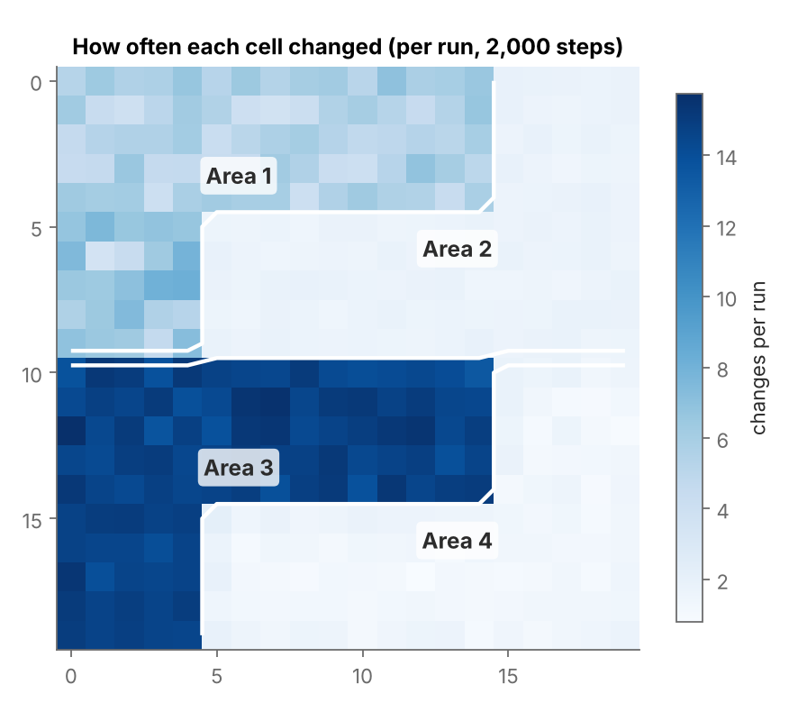
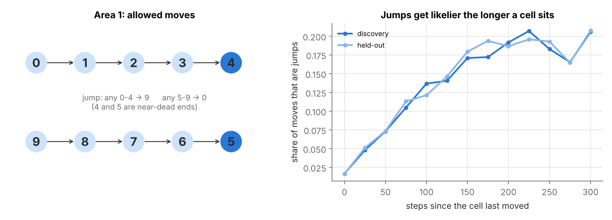
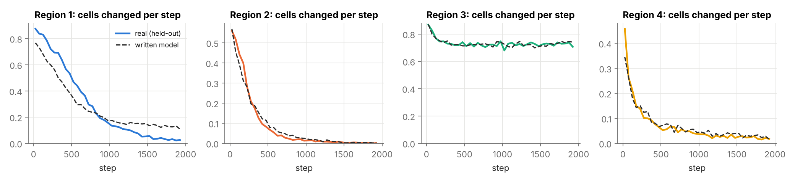

# SSIE 501 Black Box: Model Specification, Methods and Conclusions

Group 5 · Fall 2026 · Part 2

> A live, editable version of this document (with drawn diagrams) is kept as a shared doc; this file is the repository copy. Every number in the tables is generated by [`analysis/08_model_spec.py`](analysis/08_model_spec.py) and saved in [`results/model_tables.json`](results/model_tables.json).

## Purpose and how to use this document

The Black Box is four independent random processes, one per region. This document specifies each one precisely enough to rebuild it without our code.

- **Part A is the model:** the grid, what each cell remembers, and one step of the box as numbered instructions, with every probability you need.
- **Part B is the methods and conclusions:** what we measured, which explanations we tested and rejected, and why we believe the rules in Part A.

You can rebuild the model with a spreadsheet, a program in any language, or graph paper and a random-number table. Section A9 lists the numbers a correct rebuild should reproduce.

Every finding carries a claim tag such as (C12). The tag points to the script that computes it, the output it printed and an automatic test, all in this repository (see [References](#references-where-every-claim-is-proven)). The code is the evidence; this document is the model.

---

## Part A. The model

### A1. The grid, the four regions and what each cell remembers

The box is a 20 × 20 grid of cells, and each cell holds a whole number, usually 0 to 9. The grid is cut into four L-shaped regions of exactly 100 cells each; the cut moves 5 columns at the halfway row (C01). In this document, rows and columns are numbered 1 to 20 from the top-left corner (the code counts from 0).

| Region | Position | Cells (rows, columns) | What it does over time |
|---|---|---|---|
| 1 | top-left L | rows 1-5, columns 1-15 **and** rows 6-10, columns 1-5 | fills up with 4s and freezes |
| 2 | top-right L | rows 1-5, columns 16-20 **and** rows 6-10, columns 6-20 | fills up with 0s and freezes |
| 3 | bottom-left L | rows 11-15, columns 1-15 **and** rows 16-20, columns 1-5 | never freezes; mostly 0s, 1s and 2s |
| 4 | bottom-right L | rows 11-15, columns 16-20 **and** rows 16-20, columns 6-20 | values only trade places; same-value clusters form |



**What a cell remembers.** Every cell stores its current value. A Region 1 cell also stores one extra number that the page never shows: the step at which the cell last changed value, or "never" if it has not changed since Reset. Nothing else is stored anywhere.

**The starting grid.** Reset fills every cell with a random digit 0-9, each digit about equally likely (9.6% to 10.3% of cells each, C04). Every Reset gives a different grid, and every Region 1 cell starts as "never moved".

### A2. One step of the box

One press of "Next n Step" with n = 1 is one step, and in one step each region changes at most one cell (Region 4: one pair).

All our data was recorded one step at a time. We treat a press with n = 10 as ten single steps, because Part 1 found that entropy depends only on the total number of steps, not on how presses are split (Kruskal-Wallis p > 0.3).

The regions do not wait for each other: all four read the grid as it was at the start of the step.

1. Copy the grid. Every rule below reads the **old** grid and writes into the **copy**.
2. **Region 1:** pick one of its 100 cells at random, each equally likely, and apply the Region 1 rule (A5).
3. **Region 2:** pick one of its 100 cells at random and apply the Region 2 rule (A6).
4. **Region 3:** pick one of its 100 cells at random and apply the Region 3 rule (A3).
5. **Region 4:** pick two different cells of its 100 at random and apply the Region 4 rule (A4).
6. The copy becomes the grid. The step counter goes up by 1.

**Evidence that this is how picking works.**

- Regions 1-3 never changed more than one cell in a step, and Region 4 always changed 0 or exactly 2 cells, in all 91 recorded runs (C02).
- The changed cell was the next cell in reading order only 1.02% of the time, which is what random picking among 100 cells gives. A top-to-bottom sweep would give about 100% (C03).

**Random numbers.** "Draw U" means a random number between 0 and 1: `RAND()` in Excel, `random()` in Python, or a 4-digit random number divided by 10,000 by hand.

- An event "with probability P" happens when U < P.
- To pick a value from a table, add up its probabilities from the top and stop at the first value where the running total is greater than U. The tables below print these running totals.

### A3. Region 3 rule: redraw the picked cell

The picked cell gets a brand-new value drawn from one fixed table; its old value and its neighbours play no part (C06, C08). Draw U and read the first row whose running total is greater than U.

| New value | Probability | Running total |
|---|---|---|
| 0 | 0.3634 | 0.3634 |
| 1 | 0.3292 | 0.6926 |
| 2 | 0.1690 | 0.8616 |
| 3 | 0.0756 | 0.9372 |
| 4 | 0.0338 | 0.9710 |
| 5 | 0.0159 | 0.9869 |
| 6 | 0.0076 | 0.9945 |
| 7 | 0.0032 | 0.9977 |
| 8 | 0.0015 | 0.9992 |
| 9 | 0.0005 | 0.9997 |
| 10 | 0.0002 | 0.9999 |
| 11 | 0.0001 | 1.0000 |

The new value can equal the old one, so a picked cell stays the same about 28% of the time once the region has settled. That is why Region 3 shows a change in only about 73% of steps (C09).

**A short way to remember it.** 0 about 36% of the time; otherwise 1 or more, where each value is about 0.47 times as likely as the one below it. This is the closest simple description we found, but the measured table fits clearly better, so the model uses the table (C33).

**The values 10-13.**

- The table has no upper limit at 9, so very rarely it produces 10 or more. These are the "out of bounds" values Dr. Costa called a glitch.
- They appear only in Region 3 (5,635 cell-steps in our data, none in the other regions), at the rate the tail of the table predicts (C10).
- Most likely the designer meant to cap the draw at 9. A rebuild that wants to look like the page should keep values up to 13; one that wants the intended rule can cap at 9.

### A4. Region 4 rule: swap only if it makes more matching neighbours

Two randomly picked cells trade values only when the trade gives them more same-value neighbours; values are never created or destroyed (C11, C12).

1. Call the two picked cells A and B, holding values a and b. If a = b, nothing happens.
2. **Count before.** Count how many of A's 8 surrounding cells hold a, and how many of B's 8 surrounding cells hold b. Add the two counts.
3. **Count after.** Imagine the swap done (A now holds b, B holds a). Count how many of A's 8 neighbours hold b, and how many of B's 8 neighbours hold a. If A and B are neighbours of each other, use the swapped values when counting.
4. **Gain** = after − before. If the gain is 0 or negative, nothing happens.
5. If the gain is 1 or more, draw U and swap A and B when U is below the rate in the table.

| Gain | Swap rate |
|---|---|
| +1 | 0.54 |
| +2 | 0.68 |
| +3 | 0.78 |
| +4 | 0.93 |
| +5 or more | 0.96 |

**What counts as a neighbour.**

- The 8 surrounding cells (sides and corners). Cells in other regions count.
- The grid does not wrap at its edges, so edge cells have fewer neighbours.
- Of 12 definitions we tried (4 or 8 neighbours, wrapped or not, matching values or closeness of values), only this one has no exceptions (C13).

**How sure we are.**

- The gain rule held for every swap we recorded: 4,022 of 4,022 in the discovery runs, 2,002 of 2,002 in the held-out runs and 9 of 9 in Group 2's frames (C12).
- The swap rates are measured, not derived. They assume one random pair is tried each step; why a profitable swap is sometimes skipped is still open (C14).

### A5. Region 1 rule: walk down a branch, or jump to the other one

Values live on two one-way branches that end in 4 and 5. A picked cell either takes one step along its branch or jumps to the start of the other branch (C16).

- **Low branch:** 0 → 1 → 2 → 3 → **4**. A jump from 0, 1, 2 or 3 goes to **9**.
- **High branch:** 9 → 8 → 7 → 6 → **5**. A jump from 6, 7, 8 or 9 goes to **0**.



1. **If the picked cell holds 4:** draw U; if U < 0.013 it becomes 9, otherwise nothing happens.
2. **If it holds 5:** draw U; if U < 0.065 it becomes 0, otherwise nothing happens.
3. **Otherwise it always changes.** Find its waiting time: the current step minus the step at which this cell last changed ("first move" if it has never changed since Reset). Look up the jump rate in the table for its branch and waiting time.
4. Draw U. If U < the jump rate, **jump**: a low-branch cell becomes 9, a high-branch cell becomes 0. Otherwise **advance**: a low-branch cell goes up by 1, a high-branch cell goes down by 1.
5. Whenever the cell changes (steps 1-4), write down the current step as its "last changed" step.

| Waiting time since the cell last changed | Jump rate, low branch (0-3) | Jump rate, high branch (6-9) |
|---|---|---|
| first move after Reset | 0.36 | 0.63 |
| 0-49 steps | 0.02 | 0.06 |
| 50-99 steps | 0.04 | 0.18 |
| 100-149 steps | 0.08 | 0.26 |
| 150-199 steps | 0.09 | 0.33 |
| 200 steps or more | 0.10 | 0.39 |

**Why it ends in 4s.**

- Both branches drain into dead ends, so the region freezes: by the last recorded step, 99% of its cells are 4 or 5 (C17).
- It ends mostly in 4s (79%) because high-branch cells jump about four times as often as low-branch cells, which sends them across to the low branch (C18b).
- A 5 also leaves its dead end five times as often as a 4 (C17).
- With one shared jump rate for both branches, a rebuilt box ends with only 44% 4s instead of the real 80% (C30).

**How sure we are.**

- The two kinds of move are certain: 34,547 changes in the discovery runs and 17,148 in the held-out runs, with no other kind of change (C16).
- The jump rates are measured, not derived. They depend on the cell's own history: the rate rises from 2% to 21% as the time since its last change grows from under 25 to over 300 steps, the same in both datasets (C19).
- No neighbour decides a jump: across every direction and neighbour value, the jump rate stays between 10% and 24% (C20).
- This points to a hidden per-cell clock that the page does not display.

### A6. Region 2 rule: drop freely, rise only by the odd/even rule

0 never changes. Any other value either stays, drops to any lower value, or rises. It can only rise to a value it reaches by multiplying by a whole number and keeping the last digit (C21, C22, C23).

- **Rises allowed:** from 1, 3, 7 or 9 to anything higher; from 2, 4, 6 or 8 only to a higher **even** value; from 5, never. (Multiplying 5 by any whole number ends in 0 or 5; multiplying an even number always ends in an even digit.)
- **Drops allowed:** to every lower value, 0 included.

1. **If the picked cell holds 0:** nothing happens.
2. Otherwise draw U. If U is not below the change rate in the table's first column, nothing happens.
3. If it changes, draw a second U and pick the new value from that row of the table (running totals left to right). Every probability in a row already follows the rise rule: the forbidden values are 0.00.

| Old value | Change rate when picked | → 0 | → 1 | → 2 | → 3 | → 4 | → 5 | → 6 | → 7 | → 8 | → 9 |
|---|---|---|---|---|---|---|---|---|---|---|---|
| 1 | 0.26 | 0.88 | – | 0.01 | 0.02 | 0.02 | 0.01 | 0.02 | 0.01 | 0.02 | 0.01 |
| 2 | 0.54 | 0.53 | 0.26 | – | 0.00 | 0.08 | 0.00 | 0.06 | 0.00 | 0.07 | 0.00 |
| 3 | 0.60 | 0.39 | 0.24 | 0.20 | – | 0.03 | 0.03 | 0.04 | 0.02 | 0.03 | 0.02 |
| 4 | 0.73 | 0.48 | 0.11 | 0.17 | 0.06 | – | 0.00 | 0.10 | 0.00 | 0.08 | 0.00 |
| 5 | 0.67 | 0.65 | 0.13 | 0.09 | 0.07 | 0.06 | – | 0.00 | 0.00 | 0.00 | 0.00 |
| 6 | 0.79 | 0.49 | 0.07 | 0.14 | 0.04 | 0.13 | 0.03 | – | 0.00 | 0.10 | 0.00 |
| 7 | 0.89 | 0.28 | 0.11 | 0.12 | 0.09 | 0.11 | 0.09 | 0.09 | – | 0.06 | 0.05 |
| 8 | 0.88 | 0.47 | 0.04 | 0.15 | 0.03 | 0.16 | 0.02 | 0.11 | 0.02 | – | 0.00 |
| 9 | 0.92 | 0.29 | 0.10 | 0.14 | 0.10 | 0.08 | 0.08 | 0.08 | 0.06 | 0.07 | – |

Each row adds up to exactly 1.00. The change rates and new-value probabilities are measured on the discovery runs (C31). They agree with the held-out runs within 0.07 (C24).

**How sure we are.**

- The allowed and forbidden moves are certain. In all three datasets, no change ever broke the rise rule or left 0, and every allowed rise and every drop was seen at least once (C21-C23).
- The rates are measured, not derived.
- The model leaves out one effect we measured but could not pin down: a changing cell drops to 0 more often when more of its neighbours are 0 (32% with none, 89% with all eight). It is not simply copying a neighbour (C25).

### A7. Worked examples from a real run

Each example below is a real change in held-out run 1 (shared dataset, trajectory 001), checked against the rules by hand (C34). Rows and columns are numbered from 1.

**Region 1, advance.** Cell row 2, column 4 holds 9 (high branch). It is picked, does not jump, and advances: 9 → **8**.

**Region 1, jump.** Cell row 3, column 12 holds 0 (low branch). It is picked and jumps to the start of the high branch: 0 → **9**.

**Region 2, rise.** Cell row 10, column 10 holds 1. Since 1 × 6 = 6, it may rise to 6, and it does: 1 → **6**. A 2 could never do this: 2 × anything ends in an even digit, so 2 → 3, 5, 7, 9 are forbidden.

**Region 2, drop.** Cell row 3, column 16 holds 6 and drops: 6 → **1**. Drops to any lower value are allowed.

**Region 3, redraw.** Cell row 15, column 13 holds 0 and is redrawn as **1** (probability 0.33).

**Region 4, swap.** Cell A (row 18, column 16) holds 0 and cell B (row 19, column 11) holds 6. Their neighbourhoods before the swap, picked cell in brackets:

```text
A before      B before
1  8  8       6  4  6
8 [0] 8       0 [6] 3
6  8  5       0  7  3
```

- **Before:** A's neighbours hold no 0 (count 0); B's neighbours hold two 6s (count 2). Total **2**.
- **After** (A holds 6, B holds 0): A's neighbours hold one 6 (count 1); B's neighbours hold two 0s (count 2). Total **3**.
- **Gain = 3 − 2 = +1**, so the swap is allowed and happens with rate 0.54. In the real run it happened.

### A8. The minimum model and smaller boxes

Three of the four rules act on a single cell with no neighbours, so the model can be built much smaller than 20 × 20. These are consequences of the rules above; we could not test other sizes, because the real box has only one.

| Region | What one update needs | Smallest working unit |
|---|---|---|
| 3 | the picked cell only | 1 cell |
| 1 | the picked cell and the step it last changed | 1 cell plus a step counter |
| 2 | the picked cell only (in the model) | 1 cell |
| 4 | two cells and the 8 neighbours of each | a block with room for pairs and their neighbours |

- **Regions are independent**, with one exception: Region 4 counts neighbours across region borders, so its border cells see values from Regions 2 and 3.
- **Time depends on region size.**
  - With 100 cells, each cell is picked on average once every 100 steps. A region of N cells picks each cell once every N steps, so it settles N/100 times as fast.
  - Region 1's waiting-time table is in steps of a 100-cell region. For another size, scaling the waiting times by N/100 is the natural choice, but untested.
- **Keep the four regions the same size** (or keep the ratio) so their speeds stay in step, as Lauren noted in the group chat.

### A9. How to check a rebuild

A correct rebuild of this written model, run 2,000 steps from a random grid and averaged over about 30 runs, should land near the middle column; the real box gives the right column. We checked this ourselves with a line-by-line implementation of the specification ([`blackbox/spec_model.py`](blackbox/spec_model.py)) that reads only the rounded tables printed above (C32).

| Statistic after 2,000 steps (mean of 30 runs) | This written model | Real box (held-out runs) |
|---|---|---|
| Region 1: cells changed per run | 552 | 572 |
| Region 2: cells changed per run | 170 | 165 |
| Region 3: cells changed per run | 1,463 | 1,461 |
| Region 4: cells changed per run | 141 | 133 |
| Region 1: entropy at the end (bits) | 1.31 | 0.78 |
| Region 2: entropy at the end (bits) | 0.03 | 0.04 |
| Region 3: entropy at the end (bits) | 2.06 | 2.09 |
| Region 4: entropy at the end (bits) | 3.26 | 3.26 (never changes) |
| Region 1: share of cells that are 4 | 75% | 80% |
| Region 1: share of cells that are 4 or 5 | 90% | 98% |
| Region 2: share of cells that are 0 | 100% | 99% |



Regions 2, 3 and 4 match closely. Region 1 matches its activity and its majority of 4s, but leaves more cells unfinished than the real box. Its jump timing is the least certain part of the model (B4).

---

## Part B. Methods and conclusions

### B1. Data: what we recorded and how

Every rule was found on one dataset and then tested on a second dataset that was never used to find it. All datasets record the grid of the numerical page (`BlackBox_N.php`) after every single step, starting from Reset.

| Dataset | Used for | Size | How it was collected |
|---|---|---|---|
| Discovery: Group 1 scraper runs | finding the rules and fitting every probability in Part A | 61 runs × 2,000 steps | Python script (`requests` + `BeautifulSoup`): press Reset, press "Next n Step" with n = 1, read the 20 × 20 grid from the page, repeat |
| Held-out: shared dataset (W. Zhang, posted for the class) | testing only | 30 runs × 2,000 steps | Selenium browser controller from the shared starter notebook |
| Group 2 frames | extra check | 1 run × 40 steps | Python script `blackbox_collect.py` (`requests` + `BeautifulSoup`) |

- **Checks on the data.** Our loader refuses any file whose frames are not consecutive single steps. No held-out starting grid appears in the discovery set: 91 resets gave 91 different grids (C04).
- **Only the visible grid.** The scripts read the grid exactly as the page shows it. The rules were inferred from those recorded grids, not from the page's program.
- **One step = one press with n = 1.** Steps are numbered from Reset.

The analysis is a set of Python scripts in this repository, grouped by region. Each finding is printed with its claim tag and re-tested by `check_claims.py`; all 35 checks pass.

### B2. How each rule was found: what we tested, rejected and kept

For every region we followed the same five steps. Each explanation below was kept only if it survived the held-out runs.

1. List every change that ever happens in the region (old value → new value, how many cells per step).
2. Look for what decides each change: the old value, the neighbours, the position, the time since Reset, the cell's own history.
3. State the simplest rule that accounts for every change.
4. Test the rule on the held-out runs, which played no part in finding it.
5. Rebuild the whole box from the rules and compare it with the held-out runs (C28, C32).

| Region | Explanation tested | Test | Result | Claim |
|---|---|---|---|---|
| All | Cells update in a top-to-bottom, left-to-right sweep (our Part 1 claim) | How often the next change is the next cell in reading order | 1.02% (random picking gives about 1%) | **Rejected** (C03) |
| All | One random cell per region per step (Region 4: one pair) | Cells changed per step; predicted vs observed change counts | Never more than 1 (or 2); counts within 0.2-0.5% | **Kept** (C02, C09, C17) |
| All | Cells that match their neighbours stop changing (our Part 1 claim) | Change rate by number of matching neighbours | Flat: varies by at most 13 percentage points | **Rejected** (C05) |
| 3 | The new value depends on the old value | Transition table rows | Rows nearly identical | **Rejected** (C06) |
| 3 | The new value depends on the neighbours | P(new = 0) by number of zero neighbours | 0.31-0.33 throughout | **Rejected** (C08) |
| 3 | Redraw from one fixed table | Held-out distribution and change count | χ² p = 0.97; count off by 0.2% | **Kept** (C09) |
| 3 | A textbook distribution (Poisson, geometric, negative binomial and two zero-inflated forms) | Likelihood (AIC) against the free table | Table better by 128 AIC points; Poisson worst | **Rejected** (C33) |
| 4 | Values only trade places | Exact swaps; value counts over time | 6,033 of 6,033 exact swaps; counts never change | **Kept** (C11) |
| 4 | Random swaps | Matching-neighbour gain of every swap | Every swap had gain ≥ 1, in all datasets | **Rejected** (C12) |
| 4 | 11 other definitions of a "better" swap | Held-out swaps that break each definition | 126 to 828 exceptions each | **Rejected** (C13) |
| 4 | Its slow-down is caused by Regions 1-2 (our Part 1 open question) | Predict the swap rate from Region 4's own grid only | Matches within 0.01 per step after step 200 | **Not needed** (C15) |
| 1 | Any value can change into any other | All observed changes | Only advance or jump, no exceptions | **Kept: two branches** (C16) |
| 1 | A neighbour decides whether a cell jumps | Jump rate by each neighbour's direction and value | Always 10-24%, never near 0% or 100% | **Rejected** (C20) |
| 1 | Jumps depend on the cell's own history | Jump rate by time since its last change | Rises from 2% to 21%, same in both datasets | **Kept, as measured rates** (C18, C19) |
| 1 | Both branches jump equally often | Rebuilt box with one shared rate | Ends with 44% 4s instead of 80% | **Rejected** (C30) |
| 2 | 0 can change | Changes away from 0 | None, in all datasets | **Rejected: 0 is a dead end** (C21) |
| 2 | A changing cell copies a neighbour | New value among own neighbours vs a random cell's | 77% vs 73% | **Rejected** (C25) |
| 2 | Rises only to multiples of gcd(value, 10) (the instructor's odd/even hint) | Rises seen vs predicted; violations | Exact match; zero violations | **Kept** (C22) |

Marcus's independent analysis on his own runs (described in the group chat on 13 November 2026) reached the same Region 3 numbers: 0 about 36%, 1 about 33%, 2 about 17%, 3 about 7%.

### B3. Conclusions: what the box is and why we believe it

The Black Box is four separate random processes sharing one screen, each built from a different idea: a random redraw, a sorting rule, two one-way chains, and a number-theory filter.

| Region | What it is | Why we believe it |
|---|---|---|
| 3 | A pure noise source: the picked cell is redrawn from a fixed table, with no memory and no neighbours. Its entropy settles at the table's own entropy, 2.14 bits, against 2.09 measured (C27). The values 10-13 are the table's uncapped tail, which is why they appear only here. | The held-out runs follow the same table (χ² p = 0.97), and the predicted number of changes is off by 0.2% (C09). |
| 4 | A sorting process like Schelling's segregation model: two cells trade places only if that makes them more like their neighbours. Counts never change, so its entropy is fixed at 3.26 bits. It slows down because profitable swaps run out as clusters form. | Every recorded swap, 6,033 across three datasets, increased matching neighbours, and only one of 12 definitions has no exceptions (C12, C13). Its own grid predicts its slow-down (C15). |
| 1 | Two one-way chains, 0 → 4 and 9 → 5, with random jumps to the other chain's start. Both chains end in near-dead ends, so the region freezes, and it freezes mostly as 4s because the high chain jumps far more often. | Every one of 51,732 recorded changes, across all three datasets, is an advance or a jump (C16). A rebuilt box with branch-specific rates reproduces the majority of 4s; with one shared rate it does not (C30). |
| 2 | A downhill process with a dead end at 0 and a filter on climbing: a value can only rise to a number it reaches by multiplying and keeping the last digit, so even numbers stay even and 5 can never rise. | Zero exceptions in all datasets, and every allowed move was observed (C21-C23). |

**Why entropy falls in some regions and not others.** This was the instructor's question on Part 1 (C26, C27).

- Regions 1 and 2 fall (3.25 to 0.78 bits and 3.26 to 0.04 bits) because their dead ends trap cells.
- Region 4 cannot change, because swaps keep the value counts.
- Region 3 levels off at 2.09 bits, because it keeps redrawing from the same table.

**Why we trust the model as a whole.** A box built only from the written rules and rounded tables in Part A, started from the 30 held-out starting grids, reproduces the real box's activity in all four regions and its end state in Regions 2-4 (C32).

### B4. Limitations and open questions

The structure of every rule (which changes can happen) is certain, but four rates in the model are measured rather than explained.

1. **Region 1 jump timing.**
   - The written model leaves 90% of Region 1 at 4 or 5 after 2,000 steps, against 98% in the real box (C32).
   - A cell's history clearly matters (C18, C19), which suggests a hidden clock per cell, but we have not found its exact form. The time since a cell's last change was the best single predictor we tried.
2. **Region 4 swap rates.** Only 54-96% of profitable swaps happen (C14). Either the pair is not picked uniformly, or a profitable swap is accepted only with some probability; our data cannot tell these apart.
3. **Region 2 neighbour effect.** Drops to 0 are more likely next to 0s (C25). The model leaves this out, and still reproduces Region 2's activity and end state (C32).
4. **Order within a step.**
   - Six of 4,022 discovery swaps only count as profitable if a neighbouring region's change in the same step is applied first, and all six sit on a region border (C12).
   - The model applies all regions to the old grid, which is right in every other case we recorded.
5. **Step size.** All data was recorded one step at a time; presses with n > 1 are assumed to equal n single steps.
6. **Box size.** The minimum-model statements in A8 follow from the rules but could not be tested, because the real box has only one size.

### B5. Team contributions

> **To be completed.** This is a placeholder. The exact contribution of each Group 5 member to Part 2 will be filled in accurately before final submission.

| Member | Contribution to Part 2 |
|---|---|
| Kieenjal Davvey | to be completed |
| Tanya Flash | to be completed |
| Shamim Sharbaf | to be completed |
| Lauren Reed | to be completed |
| Marcus Washington | to be completed |

---

## References: where every claim is proven

To find a claim, search its tag (for example `C12`) in the script and in its output file. `python run_all.py` reruns everything in about 3 minutes, and [`results/claims_check.txt`](results/claims_check.txt) records the automatic test of every claim. [REPORT.md](REPORT.md) lists every claim with its data, code, output and test.

| Claims | What they cover | Script | Printed output |
|---|---|---|---|
| C01-C05 | regions, random picking, starting grids, neighbour matching | `analysis/01_selection.py` | `results/01_selection.txt` |
| C06-C10 | Region 3 rule and the values 10-13 | `analysis/02_area3_redraw.py` | `results/02_area3_redraw.txt` |
| C11-C15 | Region 4 rule, swap rates, slow-down | `analysis/03_area4_swaps.py` | `results/03_area4_swaps.txt` |
| C16-C20, C18b | Region 1 rule and jump rates | `analysis/04_area1_branches.py` | `results/04_area1_branches.txt` |
| C21-C25 | Region 2 rule and change rates | `analysis/05_area2_parity.py` | `results/05_area2_parity.txt` |
| C26-C27 | entropy by region | `analysis/06_entropy.py` | `results/06_entropy.txt` |
| C28-C30 | full simulator vs held-out runs | `analysis/07_simulate.py` | `results/07_simulate.txt` |
| C31-C32 | the printed tables of Part A; the written model vs held-out runs | `analysis/08_model_spec.py`, `blackbox/spec_model.py` | `results/08_model_spec.txt`, `results/model_tables.json` |
| C33 | Region 3 against textbook distributions | `analysis/09_area3_family.py` | `results/09_area3_family.txt` |
| C34 | worked examples in A7 | `analysis/10_worked_example.py` | `results/10_worked_example.txt` |

**Data credits.** Discovery runs: SSIE 501 Group 1 (scraper notebook). Held-out runs: shared dataset compiled by W. Zhang and posted for the class. Extra frames: SSIE 501 Group 2 (`blackbox_collect.py`). Analysis, model and write-up: Group 5.
