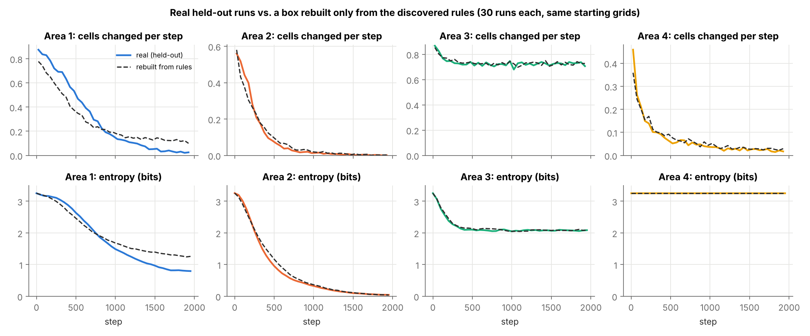

# SSIE 501 Black Box: the rule of each area, with proof

Group 5 · SSIE 501 Intro to Systems Science · Binghamton University · Fall 2026

The Black Box is a 20×20 grid that changes every step. This repository finds the rule behind each of its four areas, and backs every claim with code you can run.

**→ Read the full report: [REPORT.md](REPORT.md)**



## The answer in one table

| Area | Rule | Status |
|---|---|---|
| 3 (bottom-left) | The picked cell is redrawn from one fixed distribution (0: 36%, 1: 33%, 2: 17%, then roughly halving), ignoring the old value and the neighbours. | Solved |
| 4 (bottom-right) | Two random cells swap only if the swap increases same-value neighbours (8 neighbours, no wrap). | Rule solved, rate fitted |
| 1 (top-left) | Values move 0→1→2→3→4 or 9→8→7→6→5, or jump to the other branch's start. 4 and 5 are near-dead ends. | Moves solved, jump timing fitted |
| 2 (top-right) | 0 never changes. Drops go anywhere lower; rises only to multiples of gcd(value, 10). | Moves solved, rates fitted |

Each step, Areas 1-3 pick one random cell and Area 4 picks two.

## How everything is proven

- Every finding in the report has an ID (C01-C30). Search for the ID in `analysis/` to find the code, and in `results/` to find the printed output.
- Rules were found on one dataset (61 runs) and tested on a separate held-out dataset (30 runs).
- `check_claims.py` re-tests all 31 claims automatically. Current status: **31/31 pass** ([results/claims_check.txt](results/claims_check.txt)).

## Run it

```bash
pip install -r requirements.txt
python run_all.py            # about 2 minutes; regenerates results/, figures/ and the claim check
```

Data must be in `data/` first; see [data/README.md](data/README.md).

## Repository map

| Path | What it is |
|---|---|
| `REPORT.md` | Full report: every finding, with figures and its claim ID |
| `analysis/01_selection.py` | How cells are picked each step (C01-C05) |
| `analysis/02_area3_redraw.py` | Area 3 rule (C06-C10) |
| `analysis/03_area4_swaps.py` | Area 4 rule (C11-C15) |
| `analysis/04_area1_branches.py` | Area 1 rule (C16-C20) |
| `analysis/05_area2_parity.py` | Area 2 rule (C21-C25) |
| `analysis/06_entropy.py` | Why entropy falls per area (C26-C27) |
| `analysis/07_simulate.py` | Rebuild the box from the rules and compare (C28-C30) |
| `blackbox/` | Shared code: data loaders, area map, event extraction, simulator |
| `check_claims.py` | Automatic PASS/FAIL test of every claim |
| `results/` | Printed output of every script (`*.txt`) and its numbers (`metrics/*.json`) |
| `figures/` | All figures, regenerated by the scripts |

## Credits

Data comes from other SSIE 501 groups: Group 1 (61 runs), W. Zhang (shared 30-run dataset) and Group 2 (41 frames). Analysis and report: Group 5.
