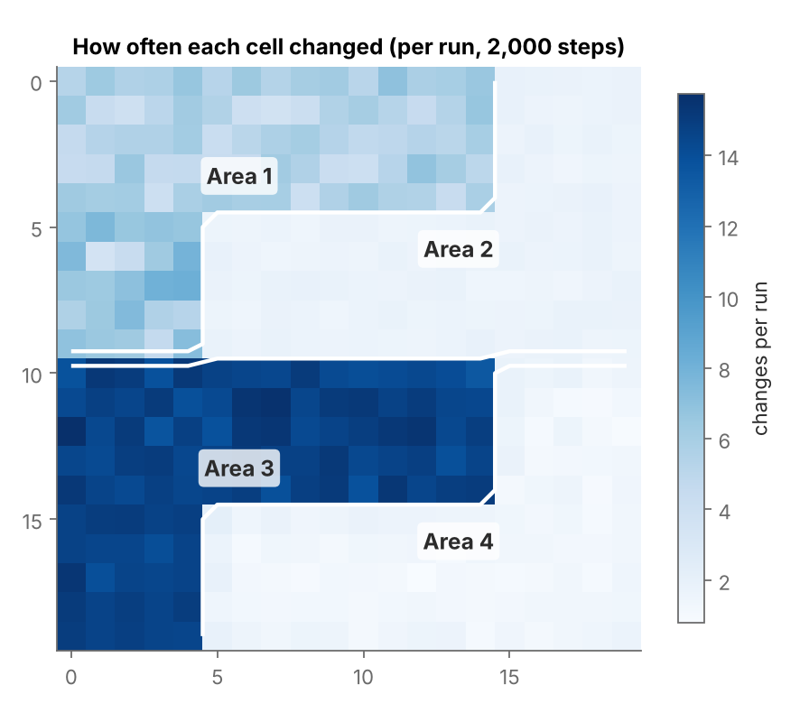
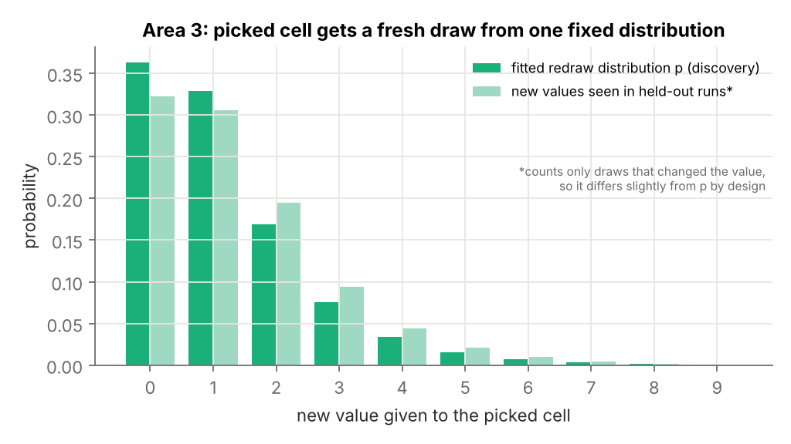
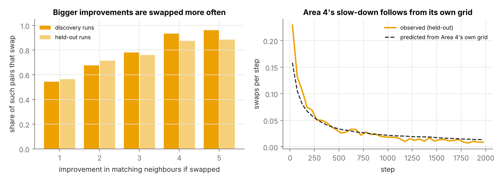
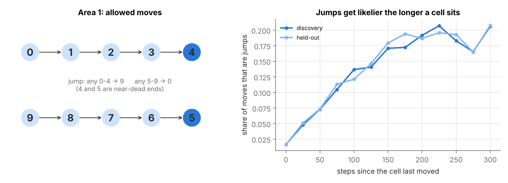
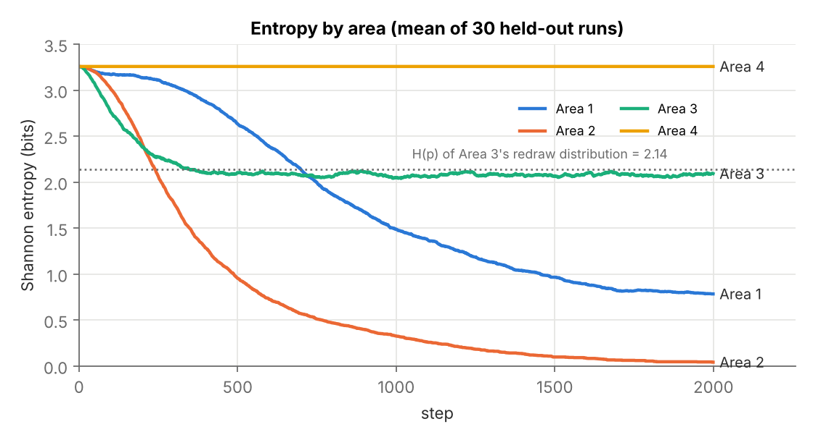
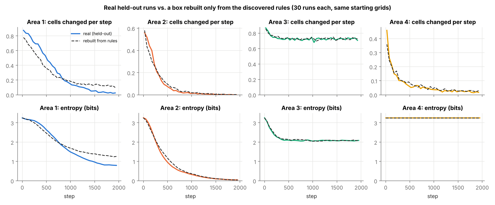

# Cracking the SSIE 501 Black Box: the update rule of each area

**SSIE 501, Fall 2026 · Group 5 · Black Box Project, Part 2 (rule discovery)**

## Summary

Every step, each of the four areas updates on its own: Areas 1-3 pick **one random cell**, Area 4 picks **two**. What happens to the picked cell is different in each area:

| Area | Where | Rule | Status |
|---|---|---|---|
| **3** | bottom-left L | The picked cell gets a **fresh random value** from one fixed distribution (0: 36%, 1: 33%, 2: 17%, then roughly halving). It ignores the old value and the neighbours. | **Solved.** Exact on held-out runs. |
| **4** | bottom-right L | Two random cells **swap** values, but only if the swap **increases the number of same-value neighbours** (8 surrounding cells, edges not wrapped). | **Rule solved.** The swap rate is fitted. |
| **1** | top-left L | Values walk one way along two branches, **0→1→2→3→4** and **9→8→7→6→5**, or **jump** to the start of the other branch. 4 and 5 are near-dead ends. | **Allowed moves solved.** When a cell jumps is random; the rate is fitted. |
| **2** | top-right L | **0 never changes.** A cell can drop to any lower value but can only **rise** to a multiple of gcd(value, 10): even values stay even when rising, and 5 never rises. | **Allowed moves solved.** The probabilities are fitted. |

**Every rule was found on one dataset (61 runs) and tested on another it never saw (30 runs).** A box rebuilt from these rules alone reproduces the held-out runs closely for Areas 2-4 and roughly for Area 1 (Section 7).

### How to check any sentence in this report

Every finding in Sections 1-7 carries a tag such as **(C12)**. That tag appears in exactly three places in the repository:

1. **The code that computes it.** Search the `analysis/` scripts for `"C12"`; each claim is one `log.claim("C12", ...)` call.
2. **The output it printed.** Search `results/*.txt` for `[C12]`; the full numbers are in `results/metrics/*.json`.
3. **An automatic test.** `check_claims.py` re-tests every claim from the saved numbers. The latest result is in [`results/claims_check.txt`](results/claims_check.txt): **31/31 pass.**

Running `python run_all.py` reproduces everything in about 2 minutes. The [claim index](#claim-index) at the end lists every claim with its code, output and test.

---

## What is new since Part 1

| Part 1 (feedback or open item) | Part 2 |
|---|---|
| "Change to **what**?" | We now give the full rule for what each picked cell becomes, per area (Sections 2-5). |
| Order of change: Part 1 claimed cells update top-to-bottom, left-to-right | **Corrected.** Cells are picked at random: the next change hits the next cell in reading order only 1.02% of the time (C03). |
| "In Areas 1-2, cells that match their neighbours stop changing" | **Corrected.** Matching neighbours does not affect whether a picked cell changes (C05). Area 1 freezes because 4 and 5 are near-dead ends (C17), and Area 2 freezes because 0 is a dead end (C21). |
| "Entropy falls. Not always, but why?" | Each area's entropy curve now follows from its rule (C26, C27). |
| Area 4's slow-down: caused by Areas 1-2? | Area 4's own grid predicts its slow-down. Improving swaps run out as same-value clusters form (C15). |
| Instructor hint: "Area 2 treats odd and even differently" | Confirmed and made exact: the mod-10 rise rule (C22). |
| "What agents? Open source or purpose built?" | Every number here comes from plain Python scripts in this repository, run on recorded data. The data sources and collection tools are listed in [Data](#data-and-method). |
| "What do you mean by activity?" | Here, **activity = number of cells that changed in one step**, measured per area. |
| Figure axes unclear (N, S, E, W) | Every figure is regenerated by code with labelled axes ([`figures/`](figures)). |
| "How do you know it is not weather?" | Reset produces a new random grid every time (C04). A box rebuilt from these rules, with no outside input, reproduces the real runs (C28). This does not *prove* there is no outside input, but none is needed to explain the behaviour. |

---

## Data and method

| Dataset | Role | Size | How it was collected |
|---|---|---|---|
| **Discovery:** Group 1 scraper runs | Used to *find* the rules | 61 runs × 2,001 frames | Python `requests` + `BeautifulSoup`: press Reset, then "Next n Step" with n = 1 and parse the grid from `BlackBox_N.php` (Group 1 notebook) |
| **Held-out:** shared dataset compiled by W. Zhang | Used only to *test* the rules | 30 runs × 2,000 frames | Selenium browser controller (shared starter notebook); different starting grids from discovery |
| **Group 2 frames** | Small extra check | 1 run × 41 frames | Python `requests` + `BeautifulSoup` (`blackbox_collect.py`) |

All three record the grid after **every single step**, and the loader checks this (`blackbox/data.py`). None of the held-out starting grids appears in the discovery set (C04 counts 91 distinct starts in 91 resets). The datasets were shared by other SSIE 501 groups and are credited here; see [`data/README.md`](data/README.md).

**Method.** For each area we (1) list which changes ever happen, (2) look for what decides them (old value, neighbours, position, time, the cell's history), (3) state the rule, (4) test the rule on the held-out runs, and (5) rebuild the whole box from the rules and compare it with the held-out runs.

The four areas are L-shapes of exactly 100 cells: the boundary moves 5 columns at the half-way row. Their exact coordinates are in `blackbox/regions.py`.

---

## 1. How the box updates: one random pick per area per step
Code: [`analysis/01_selection.py`](analysis/01_selection.py) · Output: [`results/01_selection.txt`](results/01_selection.txt)



- The grid splits into four L-shaped areas of 100 cells each, with very different activity: per 2,000-step run, an average cell changes 5.7 times in Area 1, 1.7 in Area 2, 14.6 in Area 3 and 1.3 in Area 4 (C01).
- In every dataset, Areas 1-3 never change more than one cell in a step, and Area 4 changes either 0 or exactly 2 cells (C02).
- The changed cell is picked at random, not in a sweep. In Area 3, the next changed cell is the next cell in reading order only 1.02% of the time, which is what random picking among 100 cells gives (about 1%); a sweep would give about 100%. Changes are spread evenly over the 100 cells (χ² p = 0.81) (C03).
- Reset produces a new random grid every time: 91 distinct starting grids in 91 resets, with each digit filling 9.6-10.3% of the grid (C04).
- Whether a picked cell changes does **not** depend on how many of its neighbours match it. In Area 3, and for Area 1 values other than 4 and 5, the change probability is flat across 0-4 matching side-neighbours (largest spread 13 percentage points). A picked Area 1 cell that is not 4 or 5 changes essentially every time (C05).

Because exactly one of 100 cells is picked per step, **P(change | picked) ≈ 100 × (per-step change rate of a cell)**. Sections 4-5 use this conversion.

---

## 2. Area 3: the picked cell is redrawn from a fixed distribution
Code: [`analysis/02_area3_redraw.py`](analysis/02_area3_redraw.py) · Output: [`results/02_area3_redraw.txt`](results/02_area3_redraw.txt)



- **The new value does not depend on the old value.** The rows of the old→new transition table are nearly identical: P(→0) is 0.35-0.39, P(→1) is 0.32-0.37, P(→2) is 0.14-0.21 and P(→3) is 0.07-0.08 for every old value (C06).
- **The draw distribution** fitted on discovery runs is P(0)=0.363, P(1)=0.329, P(2)=0.169, P(3)=0.076, P(4)=0.034, P(5)=0.016, P(6)=0.008, P(7)=0.003. Above 1, each value is about half as likely as the one before (ratios 0.43-0.51) (C07).
- **The new value ignores the neighbours.** P(new = 0) stays between 0.31 and 0.33 whether 0 or 7 of the 8 neighbours are 0 (C08).
- **Held-out test:** the new values in the held-out runs follow the same distribution (χ² p = 0.97). "One random cell redrawn each step" predicts 43,923 changing steps; there were 43,823 (−0.2%) (C09).
- **This explains the odd values 10-13.** They appear only in Area 3 (5,635 cell-steps; zero in Areas 1, 2 and 4), as the rare tail of the draw, P(new ≥ 10) = 0.0003 (C10).

---

## 3. Area 4: swap only if it makes more same-value neighbours
Code: [`analysis/03_area4_swaps.py`](analysis/03_area4_swaps.py) · Output: [`results/03_area4_swaps.txt`](results/03_area4_swaps.txt)



- Every Area 4 change is two cells trading values: 6,033 of 6,033 two-cell changes are exact swaps across all datasets, so Area 4's count of each value never changes (C11).
- **The rule:** a swap happens only if it **strictly increases** the number of same-value neighbours of the two cells. Neighbours are the 8 surrounding cells, grid edges are not wrapped, and cells in other areas count. This held for 4,022/4,022 discovery swaps, **2,002/2,002 held-out swaps** and 9/9 Group 2 swaps (C12).
  - Six discovery swaps only count as improving once a neighbouring area's update from the same step is applied first. All six touch an area boundary (C12).
- **Only this definition works.** Of 12 candidate definitions of "better" (4 or 8 neighbours, wrapped or not, matching values vs. value differences), only "8 neighbours, no wrap, matching" has zero non-improving held-out swaps; the others have 126-828 (C13).
- **Not every improving pair is swapped.** Assuming one random pair is tried per step, the share of improving pairs that actually swap rises with the size of the improvement: held-out +1: 0.56, +2: 0.71, +3: 0.76, +4: 0.87, +5: 0.88 (discovery: 0.54, 0.68, 0.78, 0.93, 0.96) (C14).
- **Area 4 slows down because of its own grid.** Using only Area 4's grid and the discovery swap rates, the predicted held-out swap rate per step is 0.042 vs 0.043 observed (steps 200-600), 0.024 vs 0.022 (600-1,200) and 0.016 vs 0.012 (1,200-2,000). It under-predicts the first 200 steps: 0.103 vs 0.135 (C15).

---

## 4. Area 1: two one-way branches with random jumps
Code: [`analysis/04_area1_branches.py`](analysis/04_area1_branches.py) · Output: [`results/04_area1_branches.txt`](results/04_area1_branches.txt)



- **Only two kinds of move ever happen** (C16):
  - an **advance**, one step along the cell's branch: 0→1→2→3→4 or 9→8→7→6→5;
  - a **jump** to the start of the other branch: any of 0-4 → 9, any of 5-9 → 0.
  - Counts (advance / jump / other): discovery 27,393 / 7,154 / **0**; held-out 13,570 / 3,578 / **0**; Group 2 18 / 19 / **0**.
- **Cells other than 4 and 5 always move when picked; 4 and 5 are near-dead ends.** A picked 4 or 5 leaves only 2.5% of the time (held-out): a 4 leaves 1.2% of the time, a 5 leaves 7.5%. Together these predict 17,071 changing steps vs 17,148 observed. By the last recorded step, 99% of Area 1 cells are 4 or 5, and 79% are 4 (all 91 runs) (C17).
- **Whether a moving cell jumps is random, and it depends on the cell's own history** (C18):
  - 15% of moves by non-4/5 cells are jumps.
  - A cell's first move after Reset is a jump 50% of the time (held-out: 49%).
  - Later moves are jumps 12% of the time after a jump and 8% after an advance (held-out: 13% and 8%).
- **Jumps are much more common on the high branch** (C18b):
  - Later moves jump 19% of the time on the high branch (5-9) vs 5% on the low branch (0-4), in both datasets.
  - First moves jump 63% vs 36% (held-out: 62% vs 37%).
  - Section 7 shows this is why Area 1 ends mostly 4s (C30).
- **The longer a cell has not moved, the likelier its next move is a jump:** 2% when it last moved 0-24 steps ago, 7% at 50-74 steps, 14% at 100-124, 19% at 200-224, and 21% after 300+ steps. Held-out runs give the same curve (C19).
- **Neighbours are associated with jumping but never decide it.** The jump rate rises from 6% to 32% as the number of side-neighbours on the other branch goes from 0 to 4. But across all 8 directions and every neighbour value, the jump rate stays between 10% and 24%; a deciding neighbour would push it to 0% or 100% (C20).

**Interpretation:** the dependence on a cell's history (C18, C19) suggests each cell carries a hidden variable, such as an internal clock, that the page does not display. The shared R1 research notebook (W. Zhang, `Black_box_R1_Example_Compatible.ipynb`) reached a similar "hidden age" conclusion. We report the jump rates as fitted probabilities rather than claiming a mechanism.

---

## 5. Area 2: 0 is a dead end; rises follow an odd/even rule
Code: [`analysis/05_area2_parity.py`](analysis/05_area2_parity.py) · Output: [`results/05_area2_parity.txt`](results/05_area2_parity.txt)


- **0 never changes.** Changes away from 0: discovery 0, held-out 0, Group 2 0 (C21).
- **Rises follow a mod-10 rule.** A value can only rise to a value it reaches by multiplying by a whole number mod 10, which is the same as a multiple of gcd(value, 10). So even values only rise to even values, 5 never rises, and 1, 3 and 7 can rise to anything (C22).
  - On discovery runs, the set of rises seen equals the predicted set exactly: nothing predicted is missing and nothing extra appears.
  - Changes breaking the rule: discovery 0, held-out 0, Group 2 0.
- **Drops are unrestricted.** Every drop to every lower value occurs (C23).
- **Bigger values generally change more often when picked.** P(change | picked) for values 1-9 is 0.26, 0.54, 0.60, 0.73, 0.67, 0.79, 0.89, 0.88, 0.92 on discovery runs and 0.26, 0.53, 0.62, 0.74, 0.68, 0.79, 0.85, 0.95, 0.98 on held-out runs (C24).
- **Neighbours are associated with the outcome but do not decide it** (C25):
  - A changing cell drops to 0 more often when more of its 8 neighbours are 0: 32% with none, 89% with all 8.
  - But it is not copying a neighbour: its new value appears among its own neighbours 77% of the time, vs 73% among a random Area 2 cell's neighbours.

---

## 6. Why entropy falls in some areas and not others
Code: [`analysis/06_entropy.py`](analysis/06_entropy.py) · Output: [`results/06_entropy.txt`](results/06_entropy.txt)



- Per-area Shannon entropy on held-out runs, start → last step (C26):
  - Area 1: 3.25 → 0.78 bits
  - Area 2: 3.26 → 0.04 bits
  - Area 3: 3.25 → 2.09 bits
  - Area 4: 3.26 → 3.26 bits (never moves)
  - Whole grid: 3.31 → 2.65 bits
- Each curve follows from its area's rule (C27):
  - Areas 1 and 2 fall because 4/5 (C17) and 0 (C21) trap cells.
  - Area 4 cannot change because swaps keep the value counts (C11).
  - Area 3 settles at the entropy of its draw distribution, H(p) = 2.14 bits (C07). That is close to its observed 2.09 bits; entropy measured on only 100 cells reads slightly low (C27).

---

## 7. Rebuilding the box from the rules
Code: [`blackbox/simulator.py`](blackbox/simulator.py), [`analysis/07_simulate.py`](analysis/07_simulate.py) · Output: [`results/07_simulate.txt`](results/07_simulate.txt)

The simulator implements the rules above. Its probabilities (Area 1 jump and exit rates, Area 2 change rates, Area 4 swap shares) are fitted on the **discovery** runs only. It is started from the 30 **held-out** starting grids and run for 2,000 steps.



- The rebuilt box closely reproduces Areas 2-4 and roughly reproduces Area 1 (C28):
  - Cell changes per run, real vs simulated: Area 1 572 vs 549; Area 2 165 vs 168; Area 3 1,461 vs 1,468; Area 4 133 vs 141.
  - Final entropy, real vs simulated: Area 1 0.79 vs 1.26; Area 2 0.04 vs 0.04; Area 3 2.09 vs 2.09; Area 4 3.26 vs 3.26.
- Final states on the held-out runs (C29):
  - Area 1 ends with 80% 4s (simulated 76%) and 98% 4-or-5 (simulated 90%).
  - Area 2 ends with 99% zeros (simulated 100%).
  - The rebuilt Area 1 leaves more cells mid-branch, so **the timing of Area 1's jumps is the least-understood part of the box.**
- **The branch asymmetry is what makes Area 1 end mostly 4s.** With branch-specific jump and exit rates, the rebuilt box ends with 76% 4s; with one shared rate for both branches it ends with 44% (real: 80%) (C30).

---

## 8. What we still do not know

1. **Area 1 jump timing.** What exactly decides when a cell jumps. Its dependence on the cell's history (C18, C19) points to a hidden per-cell variable.
2. **Area 4 swap rate.** Why only 56-88% of improving pairs swap (C14). The pair may not be chosen uniformly, or acceptance may be probabilistic.
3. **Area 2 probabilities.** The formula behind its change probabilities (C24) and its mild link to zero-valued neighbours (C25).
4. **Same-step order between areas.** Six Area 4 swaps suggest a neighbouring area may update first within a step (C12).

---

## Claim index

| ID | Claim (short) | Code (search for the ID) | Output | Test |
|---|---|---|---|---|
| C01 | Four L-shaped areas of 100 cells, very different activity | `analysis/01_selection.py` | `results/01_selection.txt` | `check_claims.py` |
| C02 | Areas 1-3 change ≤ 1 cell per step; Area 4 changes 0 or 2 | `analysis/01_selection.py` | `results/01_selection.txt` | `check_claims.py` |
| C03 | Cells are picked at random, not top-to-bottom | `analysis/01_selection.py` | `results/01_selection.txt` | `check_claims.py` |
| C04 | Reset gives a new random grid every time | `analysis/01_selection.py` | `results/01_selection.txt` | `check_claims.py` |
| C05 | Change does not depend on matching neighbours | `analysis/01_selection.py` | `results/01_selection.txt` | `check_claims.py` |
| C06 | Area 3 new value ignores the old value | `analysis/02_area3_redraw.py` | `results/02_area3_redraw.txt` | `check_claims.py` |
| C07 | Area 3 draw distribution | `analysis/02_area3_redraw.py` | `results/02_area3_redraw.txt` | `check_claims.py` |
| C08 | Area 3 new value ignores the neighbours | `analysis/02_area3_redraw.py` | `results/02_area3_redraw.txt` | `check_claims.py` |
| C09 | Area 3 rule holds on held-out runs | `analysis/02_area3_redraw.py` | `results/02_area3_redraw.txt` | `check_claims.py` |
| C10 | Values 10-13 only in Area 3, as the draw's tail | `analysis/02_area3_redraw.py` | `results/02_area3_redraw.txt` | `check_claims.py` |
| C11 | Area 4 changes are exact swaps | `analysis/03_area4_swaps.py` | `results/03_area4_swaps.txt` | `check_claims.py` |
| C12 | Every swap strictly increases same-value 8-neighbours | `analysis/03_area4_swaps.py` | `results/03_area4_swaps.txt` | `check_claims.py` |
| C13 | No other of 12 definitions works | `analysis/03_area4_swaps.py` | `results/03_area4_swaps.txt` | `check_claims.py` |
| C14 | Swap share rises with improvement size | `analysis/03_area4_swaps.py` | `results/03_area4_swaps.txt` | `check_claims.py` |
| C15 | Area 4's slow-down predicted from its own grid | `analysis/03_area4_swaps.py` | `results/03_area4_swaps.txt` | `check_claims.py` |
| C16 | Area 1 moves are only advance or jump | `analysis/04_area1_branches.py` | `results/04_area1_branches.txt` | `check_claims.py` |
| C17 | Non-4/5 cells always move; 4 and 5 near-dead ends | `analysis/04_area1_branches.py` | `results/04_area1_branches.txt` | `check_claims.py` |
| C18 | Jump rate depends on the cell's history | `analysis/04_area1_branches.py` | `results/04_area1_branches.txt` | `check_claims.py` |
| C18b | High branch jumps far more than low branch | `analysis/04_area1_branches.py` | `results/04_area1_branches.txt` | `check_claims.py` |
| C19 | Jump rate rises with time since last move | `analysis/04_area1_branches.py` | `results/04_area1_branches.txt` | `check_claims.py` |
| C20 | Neighbours do not decide jumps | `analysis/04_area1_branches.py` | `results/04_area1_branches.txt` | `check_claims.py` |
| C21 | Area 2: 0 never changes | `analysis/05_area2_parity.py` | `results/05_area2_parity.txt` | `check_claims.py` |
| C22 | Area 2 rises follow the mod-10 rule exactly | `analysis/05_area2_parity.py` | `results/05_area2_parity.txt` | `check_claims.py` |
| C23 | Area 2 drops are unrestricted | `analysis/05_area2_parity.py` | `results/05_area2_parity.txt` | `check_claims.py` |
| C24 | Area 2 change probability by value | `analysis/05_area2_parity.py` | `results/05_area2_parity.txt` | `check_claims.py` |
| C25 | Area 2: neighbours associated, no copying | `analysis/05_area2_parity.py` | `results/05_area2_parity.txt` | `check_claims.py` |
| C26 | Entropy curves per area | `analysis/06_entropy.py` | `results/06_entropy.txt` | `check_claims.py` |
| C27 | Each entropy curve follows from its rule | `analysis/06_entropy.py` | `results/06_entropy.txt` | `check_claims.py` |
| C28 | Rebuilt box reproduces held-out runs | `analysis/07_simulate.py` | `results/07_simulate.txt` | `check_claims.py` |
| C29 | Final states, real vs rebuilt | `analysis/07_simulate.py` | `results/07_simulate.txt` | `check_claims.py` |
| C30 | Branch asymmetry explains Area 1's 4s | `analysis/07_simulate.py` | `results/07_simulate.txt` | `check_claims.py` |

## Reproduce

```bash
pip install -r requirements.txt
python run_all.py          # runs analysis/01-07, then check_claims.py (about 2 minutes)
```

## Credits

Data: Group 1 (scraper notebook and 61 runs), W. Zhang (shared dataset and starter notebook), Group 2 (collection script and frames), all SSIE 501, Fall 2026. Analysis code, rules and report: Group 5.
