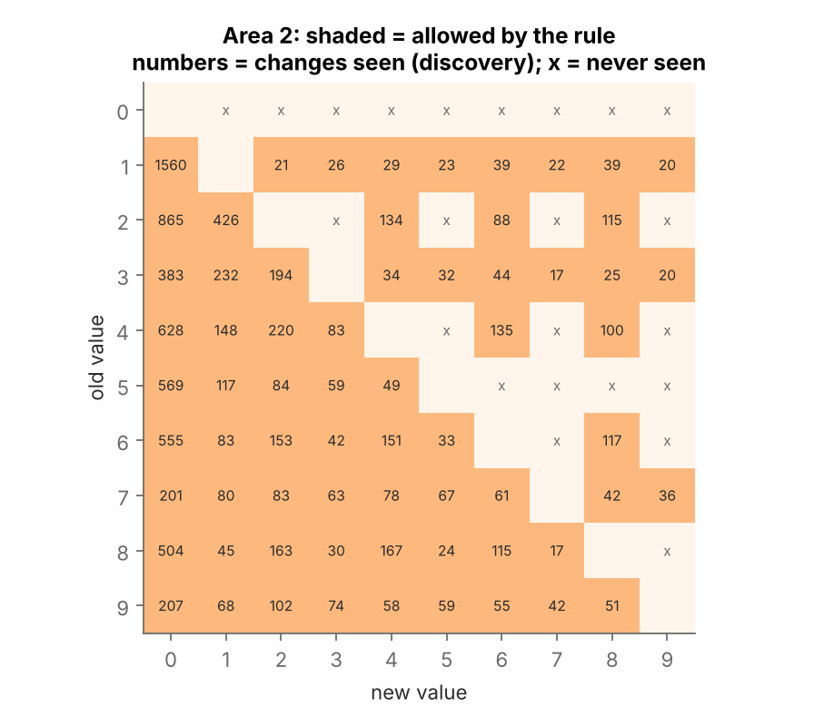

# Cracking the SSIE 501 Black Box: the update rule of each area

**SSIE 501, Fall 2026 · Group 5 · Black Box Project, Part 2 (rule discovery)**

## Summary

> **Update, 16 November 2026.** The rules for Areas 1, 2 and 4 below have been replaced by exact rules with no fitted rates: logic gates for Area 1, a minimum part and a multiply part for Area 2, and a stricter swap rule for Area 4. They were found by Marcus Washington and tested here on every held-out change (C35-C41, [Section 10](#10-update-exact-rules-for-areas-1-2-and-4)). Sections 3-5, 7 and 8 are kept as the record of the earlier analysis. [MODEL_SPECIFICATION.md](MODEL_SPECIFICATION.md) gives the current model.

Every step, each of the four areas updates on its own: Areas 1-3 pick **one random cell**, Area 4 picks **two**. What happens to the picked cell is different in each area:

| Area | Where | Rule | Status |
|---|---|---|---|
| **3** | bottom-left L | The picked cell gets a **fresh random value** from one fixed distribution (0: 36%, 1: 33%, 2: 17%, then roughly halving). It ignores the old value and the neighbours. | **Solved.** Exact on held-out runs. |
| **4** | bottom-right L | Two random cells with different values **swap** only if **neither loses same-value neighbours and at least one gains** (8 surrounding cells, edges not wrapped). | **Solved.** 2,002 of 2,002 held-out swaps (C40). |
| **1** | top-left L | Values walk one way along two branches, **0→1→2→3→4** and **9→8→7→6→5**, or **jump** to the start of the other branch when the cell's **logic gate** (a fixed rule over a few specific cells) points to the other half. | **Solved.** 16,046 of 16,046 held-out changes (C35, C36). |
| **2** | top-right L | **0 never changes.** Rows 1-10 × columns 16-20 keep the **smaller** of the cell and a random cell of rows 11-20; rows 6-10 × columns 6-15 **multiply** by a random cell of that part and keep the last digit. | **Solved.** Every held-out change fits (C38, C39). |

**Every rule was found on one dataset (61 runs) and tested on another it never saw (30 runs).** A box rebuilt from the current rules reproduces the held-out runs in all four areas (C41, Section 10).

### How to check any sentence in this report

Every finding in Sections 1-8 carries a tag such as **(C12)**. That tag appears in exactly three places in the repository:

1. **The code that computes it.** Search the `analysis/` scripts for `"C12"`; each claim is one `log.claim("C12", ...)` call.
2. **The output it printed.** Search `results/*.txt` for `[C12]`; the full numbers are in `results/metrics/*.json`.
3. **An automatic test.** `check_claims.py` re-tests every claim from the saved numbers. The latest result is in [`results/claims_check.txt`](results/claims_check.txt): **42/42 pass.**

Running `python run_all.py` reproduces everything in about 2 minutes. The [claim index](#claim-index) at the end lists every claim with its code, output and test.

---

## What is new since Part 1

| Part 1 (feedback or open item) | Part 2 |
|---|---|
| "Change to **what**?" | We now give the full rule for what each picked cell becomes, per area (Sections 2-5). |
| Order of change: Part 1 claimed cells update top-to-bottom, left-to-right | **Corrected.** Cells are picked at random: the next change hits the next cell in reading order only 1.02% of the time (C03). |
| "In Areas 1-2, cells that match their neighbours stop changing" | **Corrected.** Matching neighbours does not affect whether a picked cell changes (C05). Area 1 freezes because 4 and 5 are near-dead ends (C17), and Area 2 freezes because 0 is a dead end (C21). |
| "Entropy falls. Not always, but why?" | Each area's entropy curve now follows from its rule (C26, C27). |
| Area 4's slow-down: caused by Areas 1-2? | Area 4's own grid predicts its slow-down. Improving swaps run out as same-value clusters form (C15). |
| Instructor hint: "Area 2 treats odd and even differently" | Confirmed and made exact: the mod-10 rise rule (C22). |
| "What agents? Open source or purpose built?" | Every number here comes from plain Python scripts in this repository, run on recorded data. The data sources and collection tools are listed in [Data](#data-and-method). |
| "What do you mean by activity?" | Here, **activity = number of cells that changed in one step**, measured per area. |
| Figure axes unclear (N, S, E, W) | Every figure is regenerated by code with labelled axes ([`figures/`](figures)). |
| "How do you know it is not weather?" | Reset produces a new random grid every time (C04). A box rebuilt from these rules, with no outside input, reproduces the real runs (C28). This does not *prove* there is no outside input, but none is needed to explain the behaviour. |

---

## Data and method

| Dataset | Role | Size | How it was collected |
|---|---|---|---|
| **Discovery:** Group 1 scraper runs | Used to *find* the rules | 61 runs × 2,001 frames | Python `requests` + `BeautifulSoup`: press Reset, then "Next n Step" with n = 1 and parse the grid from `BlackBox_N.php` (Group 1 notebook) |
| **Held-out:** shared dataset compiled by W. Zhang | Used only to *test* the rules | 30 runs × 2,000 frames | Selenium browser controller (shared starter notebook); different starting grids from discovery |
| **Group 2 frames** | Small extra check | 1 run × 41 frames | Python `requests` + `BeautifulSoup` (`blackbox_collect.py`) |

All three record the grid after **every single step**, and the loader checks this (`blackbox/data.py`). None of the held-out starting grids appears in the discovery set (C04 counts 91 distinct starts in 91 resets). The datasets were shared by other SSIE 501 groups and are credited here. The held-out shared dataset is included in this repository (it was posted for the class by the instructor); the Group 1 and Group 2 files are not yet included, so `run_all.py` needs them to be placed in `data/` first. See [`data/README.md`](data/README.md).

Each section below starts with a **Data:** line saying which dataset each of its claims uses, and the [claim index](#claim-index) repeats this per claim.

**Method.** For each area we (1) list which changes ever happen, (2) look for what decides them (old value, neighbours, position, time, the cell's history), (3) state the rule, (4) test the rule on the held-out runs, and (5) rebuild the whole box from the rules and compare it with the held-out runs.

The four areas are L-shapes of exactly 100 cells: the boundary moves 5 columns at the half-way row. Their exact coordinates are in `blackbox/regions.py`.

---

## 1. How the box updates: one random pick per area per step
Code: [`analysis/01_selection.py`](analysis/01_selection.py) · Output: [`results/01_selection.txt`](results/01_selection.txt)

Data: C01, C03, C05 use discovery runs; C02 uses all three datasets; C04 uses the starting grids of discovery + held-out runs.


- The grid splits into four L-shaped areas of 100 cells each, with very different activity: per 2,000-step run, an average cell changes 5.7 times in Area 1, 1.7 in Area 2, 14.6 in Area 3 and 1.3 in Area 4 (C01).
- In every dataset, Areas 1-3 never change more than one cell in a step, and Area 4 changes either 0 or exactly 2 cells (C02).
- The changed cell is picked at random, not in a sweep. In Area 3, the next changed cell is the next cell in reading order only 1.02% of the time, which is what random picking among 100 cells gives (about 1%); a sweep would give about 100%. Changes are spread evenly over the 100 cells (χ² p = 0.81) (C03).
- Reset produces a new random grid every time: 91 distinct starting grids in 91 resets, with each digit filling 9.6-10.3% of the grid (C04).
- Whether a picked cell changes does **not** depend on how many of its neighbours match it. In Area 3, and for Area 1 values other than 4 and 5, the change probability is flat across 0-4 matching side-neighbours (largest spread 13 percentage points). A picked Area 1 cell that is not 4 or 5 changes essentially every time (C05).

Because exactly one of 100 cells is picked per step, **P(change | picked) ≈ 100 × (per-step change rate of a cell)**. Sections 4-5 use this conversion.

---

## 2. Area 3: the picked cell is redrawn from a fixed distribution
Code: [`analysis/02_area3_redraw.py`](analysis/02_area3_redraw.py) · Output: [`results/02_area3_redraw.txt`](results/02_area3_redraw.txt)

Data: C06-C08 use discovery runs (finding); C09 compares discovery with held-out runs (testing); C10 uses discovery + held-out runs.


- **The new value does not depend on the old value.** The rows of the old→new transition table are nearly identical: P(→0) is 0.35-0.39, P(→1) is 0.32-0.37, P(→2) is 0.14-0.21 and P(→3) is 0.07-0.08 for every old value (C06).
- **The draw distribution** fitted on discovery runs is P(0)=0.363, P(1)=0.329, P(2)=0.169, P(3)=0.076, P(4)=0.034, P(5)=0.016, P(6)=0.008, P(7)=0.003. Above 1, each value is about half as likely as the one before (ratios 0.43-0.51) (C07).
- **The new value ignores the neighbours.** P(new = 0) stays between 0.31 and 0.33 whether 0 or 7 of the 8 neighbours are 0 (C08).
- **Held-out test:** the new values in the held-out runs follow the same distribution (χ² p = 0.97). "One random cell redrawn each step" predicts 43,923 changing steps; there were 43,823 (−0.2%) (C09).
- **This explains the odd values 10-13.** They appear only in Area 3 (5,635 cell-steps; zero in Areas 1, 2 and 4), as the rare tail of the draw, P(new ≥ 10) = 0.0003 (C10).

---

## 3. Area 4: swap only if it makes more same-value neighbours

> **Superseded in part.** The swap rates fitted below (C14) are replaced by the stricter rule in Section 10 (C40), which needs no rates.
Code: [`analysis/03_area4_swaps.py`](analysis/03_area4_swaps.py) · Output: [`results/03_area4_swaps.txt`](results/03_area4_swaps.txt)

Data: C11 and C12 use all three datasets; C13 uses held-out runs; C14 uses discovery and held-out runs separately; C15 fits on discovery and predicts held-out runs.


- Every Area 4 change is two cells trading values: 6,033 of 6,033 two-cell changes are exact swaps across all datasets, so Area 4's count of each value never changes (C11).
- **The rule:** a swap happens only if it **strictly increases** the number of same-value neighbours of the two cells. Neighbours are the 8 surrounding cells, grid edges are not wrapped, and cells in other areas count. This held for 4,022/4,022 discovery swaps, **2,002/2,002 held-out swaps** and 9/9 Group 2 swaps (C12).
  - Six discovery swaps only count as improving once a neighbouring area's update from the same step is applied first. All six touch an area boundary (C12).
- **Only this definition works.** Of 12 candidate definitions of "better" (4 or 8 neighbours, wrapped or not, matching values vs. value differences), only "8 neighbours, no wrap, matching" has zero non-improving held-out swaps; the others have 126-828 (C13).
- **Not every improving pair is swapped.** Assuming one random pair is tried per step, the share of improving pairs that actually swap rises with the size of the improvement: held-out +1: 0.56, +2: 0.71, +3: 0.76, +4: 0.87, +5: 0.88 (discovery: 0.54, 0.68, 0.78, 0.93, 0.96) (C14).
- **Area 4 slows down because of its own grid.** Using only Area 4's grid and the discovery swap rates, the predicted held-out swap rate per step is 0.042 vs 0.043 observed (steps 200-600), 0.024 vs 0.022 (600-1,200) and 0.016 vs 0.012 (1,200-2,000). It under-predicts the first 200 steps: 0.103 vs 0.135 (C15).

---

## 4. Area 1: two one-way branches with random jumps

> **Superseded in part.** The two branches (C16) stand. The waiting-time jump rates below are replaced by the logic gates in Section 10, which decide every jump (C35-C37).
Code: [`analysis/04_area1_branches.py`](analysis/04_area1_branches.py) · Output: [`results/04_area1_branches.txt`](results/04_area1_branches.txt)

Data: C16 uses all three datasets; C17 uses held-out runs (its end-state shares use all 91 discovery + held-out runs); C18, C18b and C19 report discovery and held-out runs separately; C20 uses discovery runs.


- **Only two kinds of move ever happen** (C16):
  - an **advance**, one step along the cell's branch: 0→1→2→3→4 or 9→8→7→6→5;
  - a **jump** to the start of the other branch: any of 0-4 → 9, any of 5-9 → 0.
  - Counts (advance / jump / other): discovery 27,393 / 7,154 / **0**; held-out 13,570 / 3,578 / **0**; Group 2 18 / 19 / **0**.
- **Cells other than 4 and 5 always move when picked; 4 and 5 are near-dead ends.** A picked 4 or 5 leaves only 2.5% of the time (held-out): a 4 leaves 1.2% of the time, a 5 leaves 7.5%. Together these predict 17,071 changing steps vs 17,148 observed. By the last recorded step, 99% of Area 1 cells are 4 or 5, and 79% are 4 (all 91 runs) (C17).
- **Whether a moving cell jumps is random, and it depends on the cell's own history** (C18):
  - 15% of moves by non-4/5 cells are jumps.
  - A cell's first move after Reset is a jump 50% of the time (held-out: 49%).
  - Later moves are jumps 12% of the time after a jump and 8% after an advance (held-out: 13% and 8%).
- **Jumps are much more common on the high branch** (C18b):
  - Later moves jump 19% of the time on the high branch (5-9) vs 5% on the low branch (0-4), in both datasets.
  - First moves jump 63% vs 36% (held-out: 62% vs 37%).
  - Section 7 shows this is why Area 1 ends mostly 4s (C30).
- **The longer a cell has not moved, the likelier its next move is a jump:** 2% when it last moved 0-24 steps ago, 7% at 50-74 steps, 14% at 100-124, 19% at 200-224, and 21% after 300+ steps. Held-out runs give the same curve (C19).
- **Neighbours are associated with jumping but never decide it.** The jump rate rises from 6% to 32% as the number of side-neighbours on the other branch goes from 0 to 4. But across all 8 directions and every neighbour value, the jump rate stays between 10% and 24%; a deciding neighbour would push it to 0% or 100% (C20).

**Interpretation:** the dependence on a cell's history (C18, C19) suggests each cell carries a hidden variable, such as an internal clock, that the page does not display. The shared R1 research notebook (W. Zhang, `Black_box_R1_Example_Compatible.ipynb`) reached a similar "hidden age" conclusion. We report the jump rates as fitted probabilities rather than claiming a mechanism.

---

## 5. Area 2: 0 is a dead end; rises follow an odd/even rule

> **Superseded in part.** The dead end (C21) and the rise rule (C22) stand. The fitted probabilities below are replaced by the minimum and multiply parts in Section 10 (C38, C39).
Code: [`analysis/05_area2_parity.py`](analysis/05_area2_parity.py) · Output: [`results/05_area2_parity.txt`](results/05_area2_parity.txt)

Data: C21 and C22 use all three datasets (the 'set of rises seen' comparison uses discovery runs); C23 and C25 use discovery runs; C24 reports discovery and held-out runs separately.



- **0 never changes.** Changes away from 0: discovery 0, held-out 0, Group 2 0 (C21).
- **Rises follow a mod-10 rule.** A value can only rise to a value it reaches by multiplying by a whole number mod 10, which is the same as a multiple of gcd(value, 10). So even values only rise to even values, 5 never rises, and 1, 3 and 7 can rise to anything (C22).
  - On discovery runs, the set of rises seen equals the predicted set exactly: nothing predicted is missing and nothing extra appears.
  - Changes breaking the rule: discovery 0, held-out 0, Group 2 0.
- **Drops are unrestricted.** Every drop to every lower value occurs (C23).
- **Bigger values generally change more often when picked.** P(change | picked) for values 1-9 is 0.26, 0.54, 0.60, 0.73, 0.67, 0.79, 0.89, 0.88, 0.92 on discovery runs and 0.26, 0.53, 0.62, 0.74, 0.68, 0.79, 0.85, 0.95, 0.98 on held-out runs (C24).
- **Neighbours are associated with the outcome but do not decide it** (C25):
  - A changing cell drops to 0 more often when more of its 8 neighbours are 0: 32% with none, 89% with all 8.
  - But it is not copying a neighbour: its new value appears among its own neighbours 77% of the time, vs 73% among a random Area 2 cell's neighbours.

---

## 6. Why entropy falls in some areas and not others
Code: [`analysis/06_entropy.py`](analysis/06_entropy.py) · Output: [`results/06_entropy.txt`](results/06_entropy.txt)

Data: C26 uses held-out runs; C27 compares them with the distribution fitted on discovery runs (C07).


- Per-area Shannon entropy on held-out runs, start → last step (C26):
  - Area 1: 3.25 → 0.78 bits
  - Area 2: 3.26 → 0.04 bits
  - Area 3: 3.25 → 2.09 bits
  - Area 4: 3.26 → 3.26 bits (never moves)
  - Whole grid: 3.31 → 2.65 bits
- Each curve follows from its area's rule (C27):
  - Areas 1 and 2 fall because 4/5 (C17) and 0 (C21) trap cells.
  - Area 4 cannot change because swaps keep the value counts (C11).
  - Area 3 settles at the entropy of its draw distribution, H(p) = 2.14 bits (C07). That is close to its observed 2.09 bits; entropy measured on only 100 cells reads slightly low (C27).

---

## 7. Rebuilding the box from the rules
Code: [`blackbox/simulator.py`](blackbox/simulator.py), [`analysis/07_simulate.py`](analysis/07_simulate.py) · Output: [`results/07_simulate.txt`](results/07_simulate.txt)

Data: every probability in the simulator is fitted on discovery runs; it is started from, and compared with, the held-out runs only.

The simulator implements the rules above. Its probabilities (Area 1 jump and exit rates, Area 2 change rates, Area 4 swap shares) are fitted on the **discovery** runs only. It is started from the 30 **held-out** starting grids and run for 2,000 steps.


- The rebuilt box closely reproduces Areas 2-4 and roughly reproduces Area 1 (C28):
  - Cell changes per run, real vs simulated: Area 1 572 vs 549; Area 2 165 vs 168; Area 3 1,461 vs 1,468; Area 4 133 vs 141.
  - Final entropy, real vs simulated: Area 1 0.79 vs 1.26; Area 2 0.04 vs 0.04; Area 3 2.09 vs 2.09; Area 4 3.26 vs 3.26.
- Final states on the held-out runs (C29):
  - Area 1 ends with 80% 4s (simulated 76%) and 98% 4-or-5 (simulated 90%).
  - Area 2 ends with 99% zeros (simulated 100%).
  - The rebuilt Area 1 leaves more cells mid-branch, so **the timing of Area 1's jumps is the least-understood part of the box.**
- **The branch asymmetry is what makes Area 1 end mostly 4s.** With branch-specific jump and exit rates, the rebuilt box ends with 76% 4s; with one shared rate for both branches it ends with 44% (real: 80%) (C30).

---

## 8. The written model: a stand-alone specification, tested
Code: [`analysis/08_model_spec.py`](analysis/08_model_spec.py), [`blackbox/spec_model.py`](blackbox/spec_model.py), [`analysis/09_area3_family.py`](analysis/09_area3_family.py), [`analysis/10_worked_example.py`](analysis/10_worked_example.py) · Output: [`results/08_model_spec.txt`](results/08_model_spec.txt), [`results/model_tables.json`](results/model_tables.json), [`results/09_area3_family.txt`](results/09_area3_family.txt), [`results/10_worked_example.txt`](results/10_worked_example.txt)

Data: every table is fitted on discovery runs; the written model is started from, and compared with, the held-out runs; the worked examples come from held-out run 1.

The model specification ([MODEL_SPECIFICATION.md](MODEL_SPECIFICATION.md)) describes the box so it can be rebuilt without our code. This section tests that document itself.


- **The printed tables.** Every number in the specification is generated by code and saved to `results/model_tables.json`. Every probability row in it adds up to exactly 1 (C31).
- **The written model works on its own.** `blackbox/spec_model.py` follows the specification line by line and reads only the rounded, printed tables. Started from the 30 held-out starting grids, it gives (C32):
  - Cell changes per run, model vs real: Region 1 552 vs 572; Region 2 170 vs 165; Region 3 1,463 vs 1,461; Region 4 141 vs 133.
  - Final entropy, model vs real: Region 2 0.03 vs 0.04; Region 3 2.06 vs 2.09; Region 4 3.26 vs 3.26.
  - Region 1 again matches its activity but not its end state: 1.31 vs 0.78 bits.
- **Region 3 is not a textbook distribution.** Of five standard families, the best (a zero-inflated geometric) is still 128 AIC points worse than the measured table, and a Poisson fits worst. The closest simple description: 0 with probability 0.36, otherwise each further value about 0.47 times as likely as the one before (C33).
- **Worked examples.** One real change per region from held-out run 1, each checked against the written rules, including a Region 4 swap with a gain of +1 (C34).

---

## 9. What we still do not know

Items 1, 2 and 4 of the earlier list (Area 1 jump timing, Area 4 swap rate, same-step order) are answered in Section 10. What remains:

1. **Area 1 late activity.** After step 1,000 the real box keeps a few more Area 1 cells moving than the rebuilt box (572 vs 540 changes per run over 2,000 steps, 1.6 standard errors; C41).
2. **Area 2's link to zero-valued neighbours (C25).** Probably a side effect of zeros spreading through each part; not yet tested directly.
3. **Area 3's table** is measured, not derived (C33).

## 10. Update: exact rules for Areas 1, 2 and 4
Code: [`analysis/11_gate_rules.py`](analysis/11_gate_rules.py), [`blackbox/gate_model.py`](blackbox/gate_model.py) · Output: [`results/11_gate_rules.txt`](results/11_gate_rules.txt)

These rules come from Marcus Washington's simulator (*SSIE 501 Black Box: A Proposed Simulator for Group 5*, 4 November 2026), built on his own recorded runs. They are tested here on all 30 held-out runs, none of which was used to build them. The full rules, including the 25 Area 1 gates, are in [MODEL_SPECIFICATION.md](MODEL_SPECIFICATION.md), Part A.

- **Area 1: logic gates decide every jump.** Each cell has a target half (LOW 0-4 or HIGH 5-9) set by a fixed logic gate over a few specific cells, some of them outside Area 1. A picked cell advances along its branch when the target matches its half, and jumps when it does not. The gates predict jump or advance for **16,046 of 16,046** held-out changes from 0-3 or 6-9 (C35). Cells at 4 or 5 never jumped while their gate agreed (0 in 4.29 million cell-steps) and jumped at 1.03% per step when it disagreed, the chance of being picked (C36). The waiting-time rule of Section 4, scored on the same changes, is right 86% of the time, mostly by always guessing "advance" (C37).
- **Area 2: two parts.** In rows 1-10 × columns 16-20 the cell keeps the smaller of itself and a random cell of rows 11-20: 2,616 changes, 0 rises, every new value present in rows 11-20 (C38). In rows 6-10 × columns 6-15 it multiplies by a random cell of that part and keeps the last digit: all 2,346 changes fit (C39). The odd/even rise rule (C22) follows from the multiplication.
- **Area 4: neither cell loses.** A swap happens only if neither cell ends with fewer same-value neighbours and at least one gains; pairs are redrawn until they hold different values. All 2,002 held-out swaps fit when Areas 1-3 move first in the step, and 2,001 when every area reads the old grid, so the areas update in order 1, 2, 3, 4 (C40).
- **Rebuilt box.** Started from the 30 held-out starting grids, the rebuilt box matches the cells changed per run (Area 1: 540 vs 572; Area 2: 165 vs 165; Area 3: 1,461 vs 1,461; Area 4: 132 vs 133) and the end-state entropy of all four areas within 0.01 bits (C41).

---

## Claim index

D = discovery (Group 1, 61 runs) · H = held-out (shared dataset, 30 runs) · G2 = Group 2 (41 frames)

| ID | Claim (short) | Data | Code (search for the ID) | Output | Test |
|---|---|---|---|---|---|
| C01 | Four L-shaped areas of 100 cells, very different activity | D | `analysis/01_selection.py` | `results/01_selection.txt` | `check_claims.py` |
| C02 | Areas 1-3 change ≤ 1 cell per step; Area 4 changes 0 or 2 | D, H, G2 | `analysis/01_selection.py` | `results/01_selection.txt` | `check_claims.py` |
| C03 | Cells are picked at random, not top-to-bottom | D | `analysis/01_selection.py` | `results/01_selection.txt` | `check_claims.py` |
| C04 | Reset gives a new random grid every time | D + H starts | `analysis/01_selection.py` | `results/01_selection.txt` | `check_claims.py` |
| C05 | Change does not depend on matching neighbours | D | `analysis/01_selection.py` | `results/01_selection.txt` | `check_claims.py` |
| C06 | Area 3 new value ignores the old value | D | `analysis/02_area3_redraw.py` | `results/02_area3_redraw.txt` | `check_claims.py` |
| C07 | Area 3 draw distribution | D | `analysis/02_area3_redraw.py` | `results/02_area3_redraw.txt` | `check_claims.py` |
| C08 | Area 3 new value ignores the neighbours | D | `analysis/02_area3_redraw.py` | `results/02_area3_redraw.txt` | `check_claims.py` |
| C09 | Area 3 rule holds on held-out runs | D vs H | `analysis/02_area3_redraw.py` | `results/02_area3_redraw.txt` | `check_claims.py` |
| C10 | Values 10-13 only in Area 3, as the draw's tail | D + H | `analysis/02_area3_redraw.py` | `results/02_area3_redraw.txt` | `check_claims.py` |
| C11 | Area 4 changes are exact swaps | D, H, G2 | `analysis/03_area4_swaps.py` | `results/03_area4_swaps.txt` | `check_claims.py` |
| C12 | Every swap strictly increases same-value 8-neighbours | D, H, G2 | `analysis/03_area4_swaps.py` | `results/03_area4_swaps.txt` | `check_claims.py` |
| C13 | No other of 12 definitions works | H | `analysis/03_area4_swaps.py` | `results/03_area4_swaps.txt` | `check_claims.py` |
| C14 | Swap share rises with improvement size | D and H | `analysis/03_area4_swaps.py` | `results/03_area4_swaps.txt` | `check_claims.py` |
| C15 | Area 4's slow-down predicted from its own grid | fit D → test H | `analysis/03_area4_swaps.py` | `results/03_area4_swaps.txt` | `check_claims.py` |
| C16 | Area 1 moves are only advance or jump | D, H, G2 | `analysis/04_area1_branches.py` | `results/04_area1_branches.txt` | `check_claims.py` |
| C17 | Non-4/5 cells always move; 4 and 5 near-dead ends | H (end state D + H) | `analysis/04_area1_branches.py` | `results/04_area1_branches.txt` | `check_claims.py` |
| C18 | Jump rate depends on the cell's history | D and H | `analysis/04_area1_branches.py` | `results/04_area1_branches.txt` | `check_claims.py` |
| C18b | High branch jumps far more than low branch | D and H | `analysis/04_area1_branches.py` | `results/04_area1_branches.txt` | `check_claims.py` |
| C19 | Jump rate rises with time since last move | D and H | `analysis/04_area1_branches.py` | `results/04_area1_branches.txt` | `check_claims.py` |
| C20 | Neighbours do not decide jumps | D | `analysis/04_area1_branches.py` | `results/04_area1_branches.txt` | `check_claims.py` |
| C21 | Area 2: 0 never changes | D, H, G2 | `analysis/05_area2_parity.py` | `results/05_area2_parity.txt` | `check_claims.py` |
| C22 | Area 2 rises follow the mod-10 rule exactly | D, H, G2 | `analysis/05_area2_parity.py` | `results/05_area2_parity.txt` | `check_claims.py` |
| C23 | Area 2 drops are unrestricted | D | `analysis/05_area2_parity.py` | `results/05_area2_parity.txt` | `check_claims.py` |
| C24 | Area 2 change probability by value | D and H | `analysis/05_area2_parity.py` | `results/05_area2_parity.txt` | `check_claims.py` |
| C25 | Area 2: neighbours associated, no copying | D | `analysis/05_area2_parity.py` | `results/05_area2_parity.txt` | `check_claims.py` |
| C26 | Entropy curves per area | H | `analysis/06_entropy.py` | `results/06_entropy.txt` | `check_claims.py` |
| C27 | Each entropy curve follows from its rule | H vs D fit | `analysis/06_entropy.py` | `results/06_entropy.txt` | `check_claims.py` |
| C28 | Rebuilt box reproduces held-out runs | fit D → test H | `analysis/07_simulate.py` | `results/07_simulate.txt` | `check_claims.py` |
| C29 | Final states, real vs rebuilt | fit D → test H | `analysis/07_simulate.py` | `results/07_simulate.txt` | `check_claims.py` |
| C30 | Branch asymmetry explains Area 1's 4s | fit D → test H | `analysis/07_simulate.py` | `results/07_simulate.txt` | `check_claims.py` |
| C31 | Printed model tables, every row sums to 1 | D | `analysis/08_model_spec.py` | `results/08_model_spec.txt` | `check_claims.py` |
| C32 | The written model reproduces held-out runs | fit D → test H | `analysis/08_model_spec.py`, `blackbox/spec_model.py` | `results/08_model_spec.txt` | `check_claims.py` |
| C33 | Region 3 is not a textbook distribution | D (scored on H too) | `analysis/09_area3_family.py` | `results/09_area3_family.txt` | `check_claims.py` |
| C34 | Worked examples obey the rules | H (run 1) | `analysis/10_worked_example.py` | `results/10_worked_example.txt` | `check_claims.py` |
| C35 | Area 1 gates predict every held-out jump and advance | H | `analysis/11_gate_rules.py` | `results/11_gate_rules.txt` | `check_claims.py` |
| C36 | Settled Area 1 cells jump only when their gate disagrees | H | `analysis/11_gate_rules.py` | `results/11_gate_rules.txt` | `check_claims.py` |
| C37 | The waiting-time rule is worse than the gates | fit D → test H | `analysis/11_gate_rules.py` | `results/11_gate_rules.txt` | `check_claims.py` |
| C38 | Area 2 minimum part: never rises, new value from rows 11-20 | H | `analysis/11_gate_rules.py` | `results/11_gate_rules.txt` | `check_claims.py` |
| C39 | Area 2 multiply part: every change is a product mod 10 | H | `analysis/11_gate_rules.py` | `results/11_gate_rules.txt` | `check_claims.py` |
| C40 | Area 4 strict swap rule and update order | H | `analysis/11_gate_rules.py` | `results/11_gate_rules.txt` | `check_claims.py` |
| C41 | The current model reproduces the held-out runs | H | `analysis/11_gate_rules.py`, `blackbox/gate_model.py` | `results/11_gate_rules.txt` | `check_claims.py` |

## Reproduce

```bash
pip install -r requirements.txt
python run_all.py          # runs analysis/01-11, then check_claims.py (about 4 minutes)
```

## Team contributions

> **To be completed.** This section is a placeholder. The exact contribution of each Group 5 member to Part 2 will be filled in accurately before final submission.

| Member | Contribution to Part 2 |
|---|---|
| Kieenjal Davvey | *to be completed* |
| Tanya Flash | *to be completed* |
| Shamim Sharbaf | *to be completed* |
| Lauren Reed | *to be completed* |
| Marcus Washington | *to be completed* |

## Credits

Data: Group 1 (scraper notebook and 61 runs), W. Zhang (shared dataset and starter notebook), Group 2 (collection script and frames), all SSIE 501, Fall 2026. Area 1 gates, Area 2 parts and the strict Area 4 rule: Marcus Washington. Analysis code, rules and report: Group 5.
